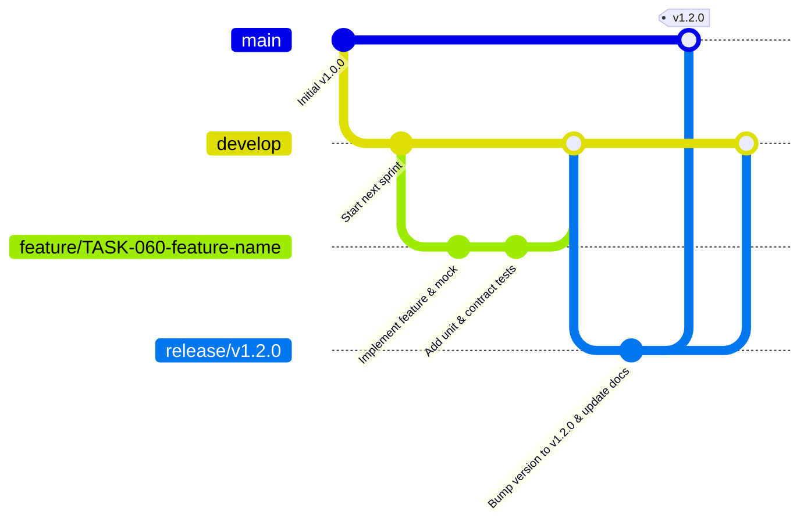
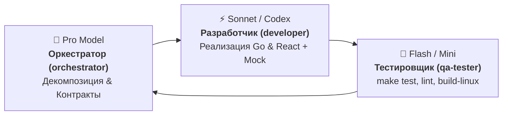

# AGENTS.md — Avari Keys AI Agent Guidelines & Gitflow Manual

Этот документ определяет правила совместной работы AI-агентов (**Antigravity** & **Codex**), архитектурные инварианты, ролевую модель, Gitflow-процессы, регламент задач и протокол верификации проекта **Avari Keys**.

---

## 1. Концепция и границы системы

**Avari Keys** — распределенная self-hosted платформа управления конфигурациями и пирами AmneziaWG (AWG) поверх скрипта `manage_amneziawg.sh` ([bivlked/amneziawg-installer](https://github.com/bivlked/amneziawg-installer)).

- **Текущая версия**: v1.2.1+
- **Стек бэкенда**: Go 1.22+ (`CGO_ENABLED=0`, чистый Go SQLite через `modernc.org/sqlite`).
- **Стек фронтенда**: React 18.3 / TypeScript 5.5 / Vite / Tailwind CSS.
- **Интеграция с AWG**: Вся работа с интерфейсами, портами, ключами и пирами AmneziaWG на нодах осуществляется исключительно через CLI-вызовы `manage_amneziawg.sh`. В тестах и dev-режиме используется встроенный mock-раннер.
- **Топология сети**:
  - **Двухкаскадное туннелирование (Double-Hop Cascade)**: Российский узел Ingress (M0) принимает замаскированный трафик и перенаправляет его на зарубежный узел Egress (S1/S4/S5P).
  - **Прямые ноды (Direct Nodes)**: Прямые высокоскоростные зарубежные серверы (S2, SBOX и др.).
  - **Резервные ноды (`is_backup`)**: Запасные серверы при недоступности основных каналов.
  - **PRO-сегментация (`is_pro`)**: Премиальные ноды и каскады с изолированной маршрутизацией трафика.
  - **Протокол Hysteria2**: Альтернативный скоростной UDP-протокол обхода блокировок.

---

## 2. Ключевые архитектурные инварианты

Каждый агент обязан неукоснительно соблюдать следующие инварианты:

### 1. Zero CGo / Static Single Binary
- Master Backend (`cmd/master`) и Slave API (`cmd/slave`) должны всегда компилироваться в статичные бинарники без внешних C-зависимостей (`CGO_ENABLED=0`).
- Реляционная БД — только чистый Go SQLite (`modernc.org/sqlite`). Запрещено добавлять зависимости, требующие `gcc` / `clang`.

### 2. Безопасность Slave API и Decoy-маскировка
- Все вызовы от Master к Slave защищены токеном через заголовок `X-API-Key`.
- Корневой эндпоинт Slave `/` всегда отдает нейтральную страницу-заглушку (Decoy) для маскировки назначения сервера от сканеров портов.

### 3. Модерация и статус пользователя
- При регистрации новый пользователь получает `is_active = false`.
- Пользователь не может создавать ключи до активации администратором (`Forve`) через веб-панель или через Telegram-бота.

### 4. Изоляция приватных ключей
- Приватные ключи клиентов генерируются исключительно скриптом `manage_amneziawg.sh` на соответствующей ноде и отдаются клиенту при создании ключа.
- Master сохраняет в SQLite только публичные метаданные (`client_name`, `public_key`, `node_id`, `user_id`, `created_at`). В БД Master **запрещено хранить приватные ключи**.

### 5. Синхронизация Mock Mode (Frontend)
- Фронтенд обязан поддерживать полноценный автономный демо-режим (`npm run dev:mock`).
- Любые новые DTO, эндпоинты или изменения формата ответов должны **синхронно** реализовываться как в боевом API-клиенте ([`apps/frontend/src/api/client.ts`](file:///Volumes/KingstonM2/Projects/avari-keys-mvp/apps/frontend/src/api/client.ts)), так и в mock-клиенте ([`apps/frontend/src/api/mockClient.ts`](file:///Volumes/KingstonM2/Projects/avari-keys-mvp/apps/frontend/src/api/mockClient.ts)). Поломка `dev:mock` недопустима.

### 6. Телеметрия трафика (Curve25519 & Delta Engine)
- Сбор статистики трафика от AmneziaWG (`awg stats`) сопоставляется с базой данных по `PublicKey`. Если для старых ключей известен только `PrivateKey`, `PublicKey` деривируется через Curve25519.
- Подсчет объема трафика ведется через инкрементальный Delta Engine в SQLite. Перезапуск демона или сброс системных счетчиков ОС не должен приводить к обнулению накопленного пользователем трафика.

### 7. Безопасность Telegram-бота
- Бот отвечает только авторизованным/привязанным пользователям (токен привязки `/link <token>`).
- Для неавторизованных чатов бот работает в режиме Decoy (не раскрывает принадлежность к VPN-сервису).
- Все административные действия (одобрение пользователей, сброс паролей) валидируются по доверенным `telegram_id` администраторов.

### 8. Кросс-платформенность компиляции бэкенда (`build tags`)
- Бэкенд должен собираться как под целевой Linux (`amd64`, `arm64`), так и под Darwin (macOS рабочие станции).
- Низкоуровневые вызовы (например, привязка сокетов `SO_BINDTODEVICE` в `internal/netprobe`) обязательно изолируются build-тегами: `//go:build linux` vs `//go:build !linux`.

### 9. SPA навигация без тяжелых зависимостей (HTML5 History API)
- Навигация между вкладками, экранами и модальными окнами реализована через HTML5 History API ([`apps/frontend/src/utils/route.ts`](file:///Volumes/KingstonM2/Projects/avari-keys-mvp/apps/frontend/src/utils/route.ts)).
- Запрещено внедрять тяжелые внешние роутеры без согласования; состояние роутов и вкладок должно сохраняться при обновлении страницы (`popstate` / F5).

### 10. Границы тестирования
- Тестируются контракты API, DTO, SQLite-хранилище, бизнес-логика модерации, биллинга, новостей, телеметрии, сетевой мониторинг и Telegram-бот.
- Работа самого ядра AmneziaWG эмулируется через Mock Runner (`internal/runner/mock_runner.go`).

---

## 3. Карта репозитория

```text
avari-keys-mvp/
├── .agents/                    # Локальные скиллы по ролям
│   └── skills/
│       ├── orchestrator/       # Скилл оркестратора (планирование, Gitflow, релизы)
│       ├── developer/          # Скилл разработчика (Go, React, mockClient, тесты)
│       └── qa-tester/          # Скилл тестировщика (go test, vet, build-linux)
├── apps/
│   ├── backend/                # Go 1.22+ backend
│   │   ├── cmd/
│   │   │   ├── master/         # Master API Gateway & Web Server
│   │   │   └── slave/          # Slave Node Agent над manage_amneziawg.sh
│   │   └── internal/
│   │       ├── auth/           # JWT, хэширование паролей, контекст пользователя
│   │       ├── client/         # Master -> Slave HTTP API Client
│   │       ├── hysteria/       # Хранилище и валидация Hysteria2 нод
│   │       ├── master/         # Обработчики Master API эндпоинтов
│   │       ├── models/         # DTO контракты и структуры данных
│   │       ├── monitor/        # HealthChecker доступности нод и телеметрия
│   │       ├── netprobe/       # Легковесные сетевые зонды с изоляцией Linux/Darwin
│   │       ├── runner/         # Интерфейс вызова CLI AWG (Real + Mock runner)
│   │       ├── slave/          # Обработчики эндпоинтов Slave API
│   │       ├── storage/        # Чистый Go SQLite (миграции, пользователи, ключи, аудит)
│   │       └── telegram/       # Бот: алерты, инлайн-модерация, сброс паролей
│   └── frontend/               # React 18.3 SPA
│       └── src/
│           ├── api/            # client.ts (боевой) и mockClient.ts (демо-режим)
│           ├── components/     # UI-компоненты (Cyber-Fantasy стилистика, маскот Ари)
│           ├── context/        # ToastContext и глобальные состояния
│           ├── types/          # TypeScript интерфейсы
│           └── utils/          # route.ts, country.ts, faqData.ts
├── deploy/                     # Конфигурации развертывания (OpenResty, Caddy, Systemd, AWG)
├── scripts/                    # Автоматизация (avari-egress.py, deploy_slave_nodes.sh и др.)
├── _docs/                      # Документация, архитектура, задачи и релизы
│   ├── tasks/                  # Отдельные спецификации задач (TASK-XXX-*.md)
│   ├── ARCHITECTURE.md         # Сетевая топология и контракты
│   ├── TASKS.md                # Канбан-доска проекта
│   └── RELEASE-vX.Y.Z.md       # Журналы версий и релизов
├── Makefile                    # Сборка, линтинг, тесты и локальный dev-запуск
└── AGENTS.md                   # Главный регламент для AI-агентов
```

---

## 4. Gitflow и управление ветками



### Правила веток:
1. **`main`**: Защищенная ветка. Содержит только стабильные протестированные релизы с тегами `vX.Y.Z`. Прямые коммиты запрещены.
2. **`develop`**: Главная интеграционная ветка. В нее сливаются протестированные фичи и фиксы.
3. **`feature/<TASK-ID>-<slug>`**:
   - Ветка под задачу из [`_docs/TASKS.md`](file:///Volumes/KingstonM2/Projects/avari-keys-mvp/_docs/TASKS.md) (например, `feature/TASK-060-speedtest-integration`).
   - Создается от актуального `develop`.
   - По завершении и прохождении проверок сливается в `develop`.
4. **`release/vX.Y.Z`**:
   - Создается от `develop` перед релизом.
   - Проводится финальный прогон тестов, обновляется версия в `package.json`, создается `_docs/RELEASE-vX.Y.Z.md`.
   - Сливается в `main` (с простановкой тега `vX.Y.Z`) и обратно в `develop`.
5. **`hotfix/vX.Y.Z`**:
   - Создается от `main` при критических инцидентах на проде. Сливается в `main` и в `develop`.

---

## 5. Регламент ведения задач (`_docs/TASKS.md`)

Перед началом работы над любой нетривиальной задачей:
1. Создать файл спецификации в `_docs/tasks/TASK-XXX-<name>.md` с разделами:
   - Цели и скоуп.
   - Затронутые модули и файлы.
   - Контракты API и структуры данных (DTO).
   - Чек-лист верификации.
2. Добавить задачу в канбан-таблицу [`_docs/TASKS.md`](file:///Volumes/KingstonM2/Projects/avari-keys-mvp/_docs/TASKS.md) со статусом `In Progress`.
3. По завершении перевести задачу в `Done` и зафиксировать итоги.

---

## 6. Ролевая модель агентов и универсальные наборы для моделей

В разработке проекта участвуют три функциональные роли, для каждой из которых подготовлен локальный скилл в `.agents/skills/`:

| Роль | Основная зона ответственности | Локальный скилл |
|---|---|---|
| **Оркестратор / Архитектор** | Декомпозиция задач, ведение [`_docs/TASKS.md`](file:///Volumes/KingstonM2/Projects/avari-keys-mvp/_docs/TASKS.md), контроль Gitflow, архитектурные решения, координация, подготовка релизов. | [`orchestrator`](file:///.agents/skills/orchestrator/SKILL.md) |
| **Разработчик / Исполнитель** | Написание Go и React кода, реализация DTO, синхронизация `client.ts` и `mockClient.ts`, модульные и контрактные тесты, фиксы багов. | [`developer`](file:///.agents/skills/developer/SKILL.md) |
| **Тестировщик / Верификатор** | Запуск тестов (`go test -race`), статический анализ (`go vet`), Zero-CGO Linux кросс-компиляция, сборка фронтенда (`npm run build`). | [`qa-tester`](file:///.agents/skills/qa-tester/SKILL.md) |

### Универсальные наборы под классы моделей

В зависимости от используемой модели (Claude, Gemini, OpenAI, DeepSeek и др.) выбирается соответствующий пресет:

#### 1. Heavyweight / Reasoning модели (Gemini 1.5/2.0/3.0 Pro, Claude 3.5 Sonnet / Opus, OpenAI o1/o3-mini)
- **Целевые роли**: **Оркестратор / Архитектор** либо **Сложный рефакторинг ядра**.
- **Активные скиллы**: [`orchestrator`](file:///.agents/skills/orchestrator/SKILL.md) + [`developer`](file:///.agents/skills/developer/SKILL.md).
- **Сильные стороны**: Анализ граничных условий, проектирование контрактов API, сложных SQLite миграций, декомпозиция крупных фич, подготовка handoff и аудит безопасности.

#### 2. Code Specialist модели (Codex, Claude 3.5 Sonnet, DeepSeek-Coder, Qwen Coder)
- **Целевая роль**: **Fullstack-разработчик (Go Backend + React Frontend)**.
- **Активный скилл**: [`developer`](file:///.agents/skills/developer/SKILL.md).
- **Сильные стороны**: Идиоматичный Go 1.22+, Zero-CGO чистый SQLite, изоляция build-тегов Linux/Darwin, строгая синхронизация `mockClient.ts`, разработка Cyber-Fantasy UI компонентов.

#### 3. Fast / High-Throughput модели (Gemini Flash / Flash-Lite, GPT-4o-mini, Claude Haiku)
- **Целевые роли**: **QA-инженер / Тестировщик**, **точечные UI-правки**, **генерация мок-данных**.
- **Активные скиллы**: [`qa-tester`](file:///.agents/skills/qa-tester/SKILL.md) (основной) или [`developer`](file:///.agents/skills/developer/SKILL.md) (для точечных правок).
- **Сильные стороны**: Мгновенный запуск и разбор логов тестов, исправление линтер-ошибок, верстка CSS-стилей, наполнение демо-данных без лишнего расхода квот.

---

### ⭐ Рекомендуемый набор (Golden Preset)

Для оптимального баланса скорости, качества кода и экономии квот рекомендуется следующая связка:



1. **Фаза планирования и архитектуры**: Модель класса **Pro** (Gemini Pro / Sonnet / o1) со скиллом [`orchestrator`](file:///.agents/skills/orchestrator/SKILL.md).
2. **Фаза кодинга**: Модель класса **Code Specialist** (Codex / Sonnet / Pro) со скиллом [`developer`](file:///.agents/skills/developer/SKILL.md).
3. **Фаза верификации и тестов**: Модель класса **Fast** (Flash / GPT-4o-mini) со скиллом [`qa-tester`](file:///.agents/skills/qa-tester/SKILL.md).

---

### Протокол передачи задачи (Handoff)

Передача задачи между агентами фиксируется в формате:

```markdown
### Handoff: [Роль/Модель -> Роль/Модель]
- **Ветка**: `feature/TASK-XXX-...`
- **Задача**: `_docs/tasks/TASK-XXX.md`
- **Объем изменений**: [Краткое резюме сделанного/требуемого]
- **Ключевые файлы**: [`apps/backend/...`](file:///...) / [`apps/frontend/...`](file:///...)
- **Синхронизация Mock Mode**: [Обновлен ли mockClient.ts (Да/Нет/Не применимо)]
- **Результаты проверки**: [Статус выполнения `make test` и `npm run build`]
- **Следующий шаг / Риски**: [Четкие инструкции следующему агенту]
```

---

## 7. Команды разработки и верификации (Checklist)

Перед коммитом или передачей задачи агент обязан выполнить верификацию:

```bash
# 1. Запуск всех тестов бэкенда (с проверкой race condition)
make test
# или: cd apps/backend && go test -v -race ./...

# 2. Проверка линтером Go и Frontend
make lint
# или: cd apps/backend && go vet ./... && cd ../frontend && npm run lint

# 3. Проверка статической компиляции (Linux amd64/arm64, Zero CGO)
make build-linux
# или: cd apps/backend && CGO_ENABLED=0 GOOS=linux GOARCH=amd64 go build -o /dev/null ./cmd/master

# 4. Проверка сборки фронтенда со строгой типизацией TypeScript
cd apps/frontend && npm run build
```

### Локальное dev-окружение:
- `make dev-ui-mock` — запуск фронтенда в чистом демо-режиме (без бэкенда) на `http://localhost:3000`.
- `make dev-ui` — запуск фронтенда с проксированием к Master API на `:8080`.
- `make dev-master` — запуск Master API (`:8080`, логин `Forve` / пароль `admin`).
- `make dev-slave-mock` — запуск Slave API в Mock-режиме на порту `:8081`.
