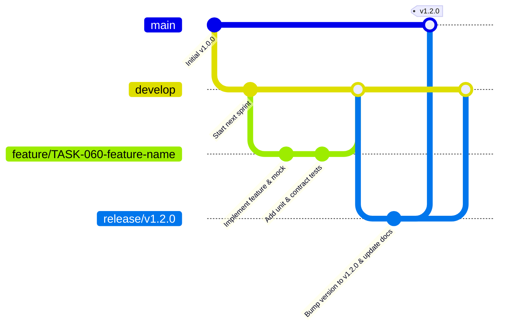
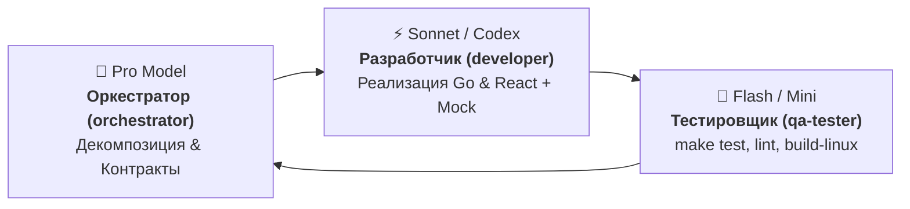

# AGENTS.md — Avari Keys AI Agent Guidelines & Gitflow Manual

Этот документ определяет правила совместной работы AI-агентов (**Antigravity** & **Codex**), архитектурные инварианты, ролевую модель, Gitflow-процессы, регламент задач и протокол верификации проекта **Avari Keys**.

---

## 1. Концепция и границы системы

**Avari Keys** — распределенная self-hosted платформа управления конфигурациями и пирами AmneziaWG (AWG) поверх скрипта `manage_amneziawg.sh` ([bivlked/amneziawg-installer](https://github.com/bivlked/amneziawg-installer)).

- **Текущая версия**: v1.6.0+
- **Стек бэкенда**: Go 1.22+ (`CGO_ENABLED=0`, чистый Go SQLite через `modernc.org/sqlite`).
- **Стек фронтенда**: React 18.3 / TypeScript 5.5 / Vite / Tailwind CSS.
- **Интеграция с AWG**: Вся работа с интерфейсами, портами, ключами и пирами AmneziaWG на нодах осуществляется исключительно через CLI-вызовы `manage_amneziawg.sh`. В тестах и dev-режиме используется встроенный mock-раннер.
- **Топология сети**:
  - **Двухкаскадное туннелирование (Double-Hop Cascade)**: Российский узел Ingress (M0) принимает замаскированный трафик и перенаправляет его на зарубежный узел Egress (S1/S4/S5P).
  - **Прямые ноды (Direct Nodes)**: Прямые высокоскоростные зарубежные серверы (S2, SBOX и др.).
  - **Резервные ноды (`is_backup`)**: Запасные серверы при недоступности основных каналов.
  - **PRO-сегментация (`is_pro`)**: Премиальные ноды и каскады с изолированной маршрутизацией трафика.
  - **Протокол Hysteria2**: Альтернативный скоростной UDP-протокол обхода блокировок.

---

## 2. Ключевые архитектурные инварианты

Каждый агент обязан неукоснительно соблюдать следующие инварианты:

### 1. Zero CGo / Static Single Binary
- Master Backend (`cmd/master`) и Slave API (`cmd/slave`) должны всегда компилироваться в статичные бинарники без внешних C-зависимостей (`CGO_ENABLED=0`).
- Реляционная БД — только чистый Go SQLite (`modernc.org/sqlite`). Запрещено добавлять зависимости, требующие `gcc` / `clang`.

### 2. Безопасность Slave API и Decoy-маскировка
- Все вызовы от Master к Slave защищены токеном через заголовок `X-API-Key`.
- Корневой эндпоинт Slave `/` всегда отдает нейтральную страницу-заглушку (Decoy) для маскировки назначения сервера от сканеров портов.

### 3. Модерация и статус пользователя
- При регистрации новый пользователь получает `is_active = false`.
- Пользователь не может создавать ключи до активации администратором (`Forve`) через веб-панель или через Telegram-бота.

### 4. Изоляция приватных ключей
- Приватные ключи клиентов генерируются исключительно скриптом `manage_amneziawg.sh` на соответствующей ноде и отдаются клиенту при создании ключа.
- Master сохраняет в SQLite только публичные метаданные (`client_name`, `public_key`, `node_id`, `user_id`, `created_at`). В БД Master **запрещено хранить приватные ключи**.

### 5. Синхронизация Mock Mode (Frontend)
- Фронтенд обязан поддерживать полноценный автономный демо-режим (`npm run dev:mock`).
- Любые новые DTO, эндпоинты или изменения формата ответов должны **синхронно** реализовываться как в боевом API-клиенте ([`apps/frontend/src/api/client.ts`](file:///Volumes/KingstonM2/Projects/avari-keys-mvp/apps/frontend/src/api/client.ts)), так и в mock-клиенте ([`apps/frontend/src/api/mockClient.ts`](file:///Volumes/KingstonM2/Projects/avari-keys-mvp/apps/frontend/src/api/mockClient.ts)). Поломка `dev:mock` недопустима.

### 6. Телеметрия трафика (Curve25519 & Delta Engine)
- Сбор статистики трафика от AmneziaWG (`awg stats`) сопоставляется с базой данных по `PublicKey`. Если для старых ключей известен только `PrivateKey`, `PublicKey` деривируется через Curve25519.
- Подсчет объема трафика ведется через инкрементальный Delta Engine в SQLite. Перезапуск демона или сброс системных счетчиков ОС не должен приводить к обнулению накопленного пользователем трафика.

### 7. Безопасность Telegram-бота
- Бот отвечает только авторизованным/привязанным пользователям (токен привязки `/link <token>`).
- Для неавторизованных чатов бот работает в режиме Decoy (не раскрывает принадлежность к VPN-сервису).
- Все административные действия (одобрение пользователей, сброс паролей) валидируются по доверенным `telegram_id` администраторов.

### 8. Кросс-платформенность компиляции бэкенда (`build tags`)
- Бэкенд должен собираться как под целевой Linux (`amd64`, `arm64`), так и под Darwin (macOS рабочие станции).
- Низкоуровневые вызовы (например, привязка сокетов `SO_BINDTODEVICE` в `internal/netprobe`) обязательно изолируются build-тегами: `//go:build linux` vs `//go:build !linux`.

### 9. SPA навигация без тяжелых зависимостей (HTML5 History API)
- Навигация между вкладками, экранами и модальными окнами реализована через HTML5 History API ([`apps/frontend/src/utils/route.ts`](file:///Volumes/KingstonM2/Projects/avari-keys-mvp/apps/frontend/src/utils/route.ts)).
- Запрещено внедрять тяжелые внешние роутеры без согласования; состояние роутов и вкладок должно сохраняться при обновлении страницы (`popstate` / F5).

### 10. Границы тестирования
- Тестируются контракты API, DTO, SQLite-хранилище, бизнес-логика модерации, биллинга, новостей, телеметрии, сетевой мониторинг и Telegram-бот.
- Работа самого ядра AmneziaWG эмулируется через Mock Runner (`internal/runner/mock_runner.go`).

### 11. Суверенитет Upstream-ядра и изоляция Downstream-дистрибуций (Brand Neutrality)
- **Нейтральность Core-репозиториев**: Все проекты экосистемы `avari-*` (`avari-keys`, `avari-gate`, `avari-mieru` и др.) являются суверенными, нейтральными базовыми платформами (Upstream Core).
- **Строгий запрет сторонней айдентики**: В исходном коде, документации, git-истории, скриптах сборки, ассетах и CI/CD upstream-репозиториев категорически запрещено наличие любых прямых упоминаний, логотипов, скриншотов, брендовых названий, URL, токенов публикации или привязок к сторонним партнерским downstream-дистрибутивам и коммерческим клиентам.
- **Нейтральный нэйминг встроенных стилей**: Все графические темы и стили внутри upstream-компонентов именуются исключительно нейтрально (например, `eyevpn`, `dragons`, `pirates`, `cyber-fantasy`), без привязки к внешним сервисам.
- **Изолированная Downstream-дистрибуция (Trigger-Based CI/CD)**:
  - Репозитории upstream отвечают исключительно за разработку ядра и выпуск собственных нейтральных версий (`avari-*`). Upstream CI/CD не должен знать о существовании сторонних репозиториев или содержать шаги публикации в них.
  - Сторонние брендированные дистрибутивы размещаются в собственных независимых downstream-репозиториях.
  - Downstream-репозиторий сам содержит свой брендовый оверлей (логотипы, splash-экраны, ID приложений, манифесты) и собственный GitHub Actions workflow.
  - Downstream CI/CD запускается автоматически по триггеру (webhook, `repository_dispatch`, тег upstream или расписание), забирает ядро/артефакты из upstream, выполняет локальную сборку/брендирование и публикует релизы для своей аудитории.
- **Протокол гигиены и перезаписи Git-истории (Zero-Leakage Sanitization)**:
  - При случайном проникновении сторонних названий или ассетов в upstream-репозитории:
    1. Репозиторий временно переводится в статус Private.
    2. Проводится полная очистка рабочего дерева и перезапись истории коммитов (`git filter-repo` / rebase) с удалением любых упоминаний и артефактов сторонних брендов.
    3. Выполняется force-push во все ветки и теги upstream с обязательным аудитом перед возвратом в публичный доступ.

### 12. Предрелизный верификационный барьер и мониторинг CI/CD (Pre-flight CI Verification & Pipeline Gate)
- **Обязательная локальная проверка всех тестов и шагов CI перед публикацией (`make check-ci`)**:
  Перед любым коммитом, слиянием веток в `develop` / `main` и созданием релизных тегов агент ОБЯЗАН запустить локальный полный верификационный комплекс:
  1. `make test` — запуск всех тестов бэкенда с флагом `-race` (100% PASS, 0 race conditions).
  2. `make lint` — проверка статическим анализатором `go vet` и линтером фронтенда.
  3. `make build-linux` — проверка статической Zero-CGo кросс-компиляции бинарников под Linux (`amd64`, `arm64`).
  4. `cd apps/frontend && npm run build` — строгая компиляция TypeScript и сборка Vite SPA без ошибок.
  5. `python3 scripts/check_private_inventory.py` — проверка репозитория на полное отсутствие приватных боевых IP-адресов, закрытых хостов и секретов инвентаря в коде, задачах и документации (Zero-Leakage Sanitization). Запрещено указывать реальные боевые IP в `_docs/`.
- **Сквозной мониторинг статуса CI/CD в GitHub Actions**:
  После пуша веток и тегов в удаленный репозиторий (`git push origin main develop --tags`) агент **НЕ ИМЕЕТ ПРАВА** рапортовать пользователю о готовности задачи/релиза без отслеживания статуса удаленного GitHub Actions workflow (`gh run list` / `gh run watch`). Доклад пользователю о завершении допускается **только при подтвержденном статусе `success` (зеленый чекбокс)** удаленного CI/CD пайплайна. Если удаленный билд упал — немедленно локализовать лог ошибки, устранить проблему и перезапустить/перепроверить пайплайн до зеленого статуса.

---

## 3. Архитектурный навигатор по подсистемам (Subsystem Quick Index)

> [!TIP]
> **Для AI-агентов (Codex, Antigravity) и разработчиков**:
> Чтобы не засорять контекстное окно чтением всей кодовой базы, перед выполнением задачи обратитесь к соответствующему модульному справочнику из каталога [`_docs/architecture/`](file:///Volumes/KingstonM2/Projects/avari-keys-mvp/_docs/architecture/INDEX.md):

| Подсистема / Задача | Фоновый справочник | Точки входа в код |
|---|---|---|
| **API Бэкенда (Master & Slave)**: роуты, middleware, доменные обработчики, Runner | [`_docs/architecture/BACKEND_STRUCTURE.md`](file:///Volumes/KingstonM2/Projects/avari-keys-mvp/_docs/architecture/BACKEND_STRUCTURE.md) | [`apps/backend/internal/master/`](file:///Volumes/KingstonM2/Projects/avari-keys-mvp/apps/backend/internal/master/) (`server.go`, `handlers_*.go`), [`internal/slave/`](file:///Volumes/KingstonM2/Projects/avari-keys-mvp/apps/backend/internal/slave/) |
| **СХД и миграции**: чистый Go SQLite, версионирование, RetentionWorker | [`_docs/architecture/STORAGE_AND_MIGRATIONS.md`](file:///Volumes/KingstonM2/Projects/avari-keys-mvp/_docs/architecture/STORAGE_AND_MIGRATIONS.md) | [`internal/storage/sqlite.go`](file:///Volumes/KingstonM2/Projects/avari-keys-mvp/apps/backend/internal/storage/sqlite.go), [`internal/retention/`](file:///Volumes/KingstonM2/Projects/avari-keys-mvp/apps/backend/internal/retention/) |
| **Каскад и Egress**: M0 $\rightarrow$ S1/S4, кворум-проверки, Auto-Failover, Watchdog | [`_docs/architecture/CASCADE_AND_EGRESS.md`](file:///Volumes/KingstonM2/Projects/avari-keys-mvp/_docs/architecture/CASCADE_AND_EGRESS.md) | [`internal/egress/`](file:///Volumes/KingstonM2/Projects/avari-keys-mvp/apps/backend/internal/egress/), [`internal/monitor/healthchecker.go`](file:///Volumes/KingstonM2/Projects/avari-keys-mvp/apps/backend/internal/monitor/healthchecker.go) |
| **Телеметрия и биллинг**: Delta Engine, Curve25519, трафик за месяц, взносы | [`_docs/architecture/TELEMETRY_AND_BILLING.md`](file:///Volumes/KingstonM2/Projects/avari-keys-mvp/_docs/architecture/TELEMETRY_AND_BILLING.md) | [`internal/storage/sqlite.go`](file:///Volumes/KingstonM2/Projects/avari-keys-mvp/apps/backend/internal/storage/sqlite.go), [`internal/master/handlers_billing.go`](file:///Volumes/KingstonM2/Projects/avari-keys-mvp/apps/backend/internal/master/handlers_billing.go) |
| **Безопасность и Auth**: Rate Limiter, 1MB limit, Decoy, Constant-time, loopback | [`_docs/architecture/SECURITY_AND_AUTH.md`](file:///Volumes/KingstonM2/Projects/avari-keys-mvp/_docs/architecture/SECURITY_AND_AUTH.md) | [`internal/master/ratelimit.go`](file:///Volumes/KingstonM2/Projects/avari-keys-mvp/apps/backend/internal/master/ratelimit.go), [`internal/auth/`](file:///Volumes/KingstonM2/Projects/avari-keys-mvp/apps/backend/internal/auth/) |
| **Telegram-бот и Mini App (TMA)**: HMAC-SHA256 initData, Decoy, inline-модерация | [`_docs/architecture/TELEGRAM_AND_TMA.md`](file:///Volumes/KingstonM2/Projects/avari-keys-mvp/_docs/architecture/TELEGRAM_AND_TMA.md) | [`internal/telegram/`](file:///Volumes/KingstonM2/Projects/avari-keys-mvp/apps/backend/internal/telegram/), [`apps/frontend/src/components/TelegramMiniApp.tsx`](file:///Volumes/KingstonM2/Projects/avari-keys-mvp/apps/frontend/src/components/TelegramMiniApp.tsx) |
| **Фронтенд SPA**: React 18, lazy loading, чанки, роутинг, обязательный мок-паритет | [`_docs/architecture/FRONTEND_SPA.md`](file:///Volumes/KingstonM2/Projects/avari-keys-mvp/_docs/architecture/FRONTEND_SPA.md) | [`apps/frontend/src/api/client.ts`](file:///Volumes/KingstonM2/Projects/avari-keys-mvp/apps/frontend/src/api/client.ts), [`mockClient.ts`](file:///Volumes/KingstonM2/Projects/avari-keys-mvp/apps/frontend/src/api/mockClient.ts), [`App.tsx`](file:///Volumes/KingstonM2/Projects/avari-keys-mvp/apps/frontend/src/App.tsx) |

---

## 4. Карта репозитория

```text
avari-keys-mvp/
├── .agents/                    # Локальные скиллы по ролям
│   └── skills/
│       ├── orchestrator/       # Скилл оркестратора (планирование, Gitflow, релизы)
│       ├── developer/          # Скилл разработчика (Go, React, mockClient, тесты)
│       └── qa-tester/          # Скилл тестировщика (go test, vet, build-linux)
├── apps/
│   ├── backend/                # Go 1.22+ backend (Zero CGo, CGO_ENABLED=0)
│   │   ├── cmd/
│   │   │   ├── master/         # Master API Gateway & Web Server (main.go)
│   │   │   └── slave/          # Slave Node Agent над manage_amneziawg.sh (main.go)
│   │   └── internal/
│   │       ├── auth/           # JWT, хэширование паролей bcrypt, контекст пользователя
│   │       ├── client/         # Master -> Slave HTTP API Client
│   │       ├── egress/         # Управление Egress-шлюзами каскада, кворум 5 целей
│   │       ├── hysteria/       # Хранилище и валидация Hysteria2 нод
│   │       ├── logger/         # log/slog структурированное логирование (JSON/Text)
│   │       ├── master/         # Декомпозированные доменные обработчики:
│   │       │   ├── server.go             # Config, Server struct, роутинг, middleware
│   │       │   ├── handlers_auth.go      # Авторизация, профиль, сброс пароля, TMA
│   │       │   ├── handlers_keys.go      # CRUD клиентских ключей, транслитерация
│   │       │   ├── handlers_nodes.go     # Управление нодами, диагностика, Egress
│   │       │   ├── handlers_admin.go     # Модерация пользователей, аудит-логи, TG
│   │       │   ├── handlers_billing.go   # Биллинг, реквизиты, дашборд
│   │       │   ├── handlers_news.go      # Новости и рассылка
│   │       │   └── ratelimit.go          # In-memory sliding-window IPRateLimiter
│   │       ├── mieru/          # Интеграция протокола Mieru (TCP-прокси, JSON, QR)
│   │       ├── models/         # DTO контракты и структуры данных
│   │       ├── monitor/        # HealthChecker доступности нод и телеметрия
│   │       ├── netprobe/       # Легковесные сетевые зонды с изоляцией Linux/Darwin
│   │       ├── retention/      # Периодическая ротация логов и телеметрии (24h)
│   │       ├── runner/         # Интерфейс вызова CLI AWG (Real + Mock runner)
│   │       ├── slave/          # Обработчики эндпоинтов Slave API (Decoy, ConstantTime)
│   │       ├── storage/        # Чистый Go SQLite (миграции, пользователи, ключи, аудит)
│   │       ├── telegram/       # Бот: алерты, инлайн-модерация, сброс паролей
│   │       └── vless/          # Контроллер и конфигурации VLESS Reality
│   └── frontend/               # React 18.3 SPA (Vite + Code-Splitting)
│       └── src/
│           ├── api/            # client.ts (боевой) и mockClient.ts (демо-режим dev:mock)
│           ├── components/     # UI-компоненты (Cyber-Fantasy стилистика, маскот Ари)
│           ├── context/        # ToastContext и глобальные состояния
│           ├── types/          # TypeScript интерфейсы
│           └── utils/          # route.ts, country.ts, faqData.ts
├── deploy/                     # Конфигурации развертывания (OpenResty, Caddy, Systemd, AWG)
├── scripts/                    # Автоматизация (deploy_slave_nodes.sh и др.)
├── _docs/                      # Документация, архитектура, задачи и релизы
│   ├── architecture/           # 📚 Модульные архитектурные справочники (INDEX.md и др.)
│   ├── tasks/                  # Отдельные спецификации задач (TASK-XXX-*.md)
│   ├── ARCHITECTURE.md         # Сетевая топология и физический реестр нод
│   ├── TASKS.md                # Канбан-доска проекта
│   └── RELEASE-vX.Y.Z.md       # Журналы версий и релизов
├── Makefile                    # Сборка, линтинг, тесты и локальный dev-запуск
└── AGENTS.md                   # Главный регламент для AI-агентов
```

---

## 5. Gitflow и управление ветками



### Правила веток:
1. **`main`**: Защищенная ветка. Содержит только стабильные протестированные релизы с тегами `vX.Y.Z`. Прямые коммиты запрещены.
2. **`develop`**: Главная интеграционная ветка. В нее сливаются протестированные фичи и фиксы.
3. **`feature/<TASK-ID>-<slug>`**:
   - Ветка под задачу из [`_docs/TASKS.md`](file:///Volumes/KingstonM2/Projects/avari-keys-mvp/_docs/TASKS.md) (например, `feature/TASK-060-speedtest-integration`).
   - Создается от актуального `develop`.
   - По завершении и прохождении проверок сливается в `develop`.
4. **`release/vX.Y.Z`**:
   - Создается от `develop` перед релизом.
   - Проводится финальный прогон тестов, обновляется версия в `package.json`, создается `_docs/RELEASE-vX.Y.Z.md`.
   - Сливается в `main` (с простановкой тега `vX.Y.Z`) и обратно в `develop`.
5. **`hotfix/vX.Y.Z`**:
   - Создается от `main` при критических инцидентах на проде. Сливается в `main` и в `develop`.

---

## 5. Регламент ведения задач (`_docs/TASKS.md`)

Перед началом работы над любой нетривиальной задачей:
1. Создать файл спецификации в `_docs/tasks/TASK-XXX-<name>.md` с разделами:
   - Цели и скоуп.
   - Затронутые модули и файлы.
   - Контракты API и структуры данных (DTO).
   - Чек-лист верификации.
2. Добавить задачу в канбан-таблицу [`_docs/TASKS.md`](file:///Volumes/KingstonM2/Projects/avari-keys-mvp/_docs/TASKS.md) со статусом `In Progress`.
3. По завершении перевести задачу в `Done` и зафиксировать итоги.

---

## 6. Ролевая модель агентов и универсальные наборы для моделей

В разработке проекта участвуют три функциональные роли, для каждой из которых подготовлен локальный скилл в `.agents/skills/`:

| Роль | Основная зона ответственности | Локальный скилл |
|---|---|---|
| **Оркестратор / Архитектор** | Декомпозиция задач, ведение [`_docs/TASKS.md`](file:///Volumes/KingstonM2/Projects/avari-keys-mvp/_docs/TASKS.md), контроль Gitflow, архитектурные решения, координация, подготовка релизов. | [`orchestrator`](file:///.agents/skills/orchestrator/SKILL.md) |
| **Разработчик / Исполнитель** | Написание Go и React кода, реализация DTO, синхронизация `client.ts` и `mockClient.ts`, модульные и контрактные тесты, фиксы багов. | [`developer`](file:///.agents/skills/developer/SKILL.md) |
| **Тестировщик / Верификатор** | Запуск тестов (`go test -race`), статический анализ (`go vet`), Zero-CGO Linux кросс-компиляция, сборка фронтенда (`npm run build`). | [`qa-tester`](file:///.agents/skills/qa-tester/SKILL.md) |

### Универсальные наборы под классы моделей

В зависимости от используемой модели (Claude, Gemini, OpenAI, DeepSeek и др.) выбирается соответствующий пресет:

#### 1. Heavyweight / Reasoning модели (Gemini 1.5/2.0/3.0 Pro, Claude 3.5 Sonnet / Opus, OpenAI o1/o3-mini)
- **Целевые роли**: **Оркестратор / Архитектор** либо **Сложный рефакторинг ядра**.
- **Активные скиллы**: [`orchestrator`](file:///.agents/skills/orchestrator/SKILL.md) + [`developer`](file:///.agents/skills/developer/SKILL.md).
- **Сильные стороны**: Анализ граничных условий, проектирование контрактов API, сложных SQLite миграций, декомпозиция крупных фич, подготовка handoff и аудит безопасности.

#### 2. Code Specialist модели (Codex, Claude 3.5 Sonnet, DeepSeek-Coder, Qwen Coder)
- **Целевая роль**: **Fullstack-разработчик (Go Backend + React Frontend)**.
- **Активный скилл**: [`developer`](file:///.agents/skills/developer/SKILL.md).
- **Сильные стороны**: Идиоматичный Go 1.22+, Zero-CGO чистый SQLite, изоляция build-тегов Linux/Darwin, строгая синхронизация `mockClient.ts`, разработка Cyber-Fantasy UI компонентов.

#### 3. Fast / High-Throughput модели (Gemini Flash / Flash-Lite, GPT-4o-mini, Claude Haiku)
- **Целевые роли**: **QA-инженер / Тестировщик**, **точечные UI-правки**, **генерация мок-данных**.
- **Активные скиллы**: [`qa-tester`](file:///.agents/skills/qa-tester/SKILL.md) (основной) или [`developer`](file:///.agents/skills/developer/SKILL.md) (для точечных правок).
- **Сильные стороны**: Мгновенный запуск и разбор логов тестов, исправление линтер-ошибок, верстка CSS-стилей, наполнение демо-данных без лишнего расхода квот.

---

### ⭐ Рекомендуемый набор (Golden Preset)

Для оптимального баланса скорости, качества кода и экономии квот рекомендуется следующая связка:



1. **Фаза планирования и архитектуры**: Модель класса **Pro** (Gemini Pro / Sonnet / o1) со скиллом [`orchestrator`](file:///.agents/skills/orchestrator/SKILL.md).
2. **Фаза кодинга**: Модель класса **Code Specialist** (Codex / Sonnet / Pro) со скиллом [`developer`](file:///.agents/skills/developer/SKILL.md).
3. **Фаза верификации и тестов**: Модель класса **Fast** (Flash / GPT-4o-mini) со скиллом [`qa-tester`](file:///.agents/skills/qa-tester/SKILL.md).

---

### Протокол передачи задачи (Handoff)

Передача задачи между агентами фиксируется в формате:

```markdown
### Handoff: [Роль/Модель -> Роль/Модель]
- **Ветка**: `feature/TASK-XXX-...`
- **Задача**: `_docs/tasks/TASK-XXX.md`
- **Объем изменений**: [Краткое резюме сделанного/требуемого]
- **Ключевые файлы**: [`apps/backend/...`](file:///...) / [`apps/frontend/...`](file:///...)
- **Синхронизация Mock Mode**: [Обновлен ли mockClient.ts (Да/Нет/Не применимо)]
- **Результаты проверки**: [Статус выполнения `make test` и `npm run build`]
- **Следующий шаг / Риски**: [Четкие инструкции следующему агенту]
```

---

## 7. Команды разработки и верификации (Checklist)

Перед коммитом или передачей задачи агент обязан выполнить верификацию:

```bash
# 1. Запуск всех тестов бэкенда (с проверкой race condition)
make test
# или: cd apps/backend && go test -v -race ./...

# 2. Проверка линтером Go и Frontend
make lint
# или: cd apps/backend && go vet ./... && cd ../frontend && npm run lint

# 3. Проверка статической компиляции (Linux amd64/arm64, Zero CGO)
make build-linux
# или: cd apps/backend && CGO_ENABLED=0 GOOS=linux GOARCH=amd64 go build -o /dev/null ./cmd/master

# 4. Проверка сборки фронтенда со строгой типизацией TypeScript
cd apps/frontend && npm run build

# 5. Проверка приватного инвентаря на отсутствие утечек боевых IP (Zero-Leakage)
python3 scripts/check_private_inventory.py

# 💡 Или единый запуск всех шагов CI перед коммитом / публикацией:
make check-ci

# 6. После git push ОБЯЗАТЕЛЬНО проверить статус удаленного GitHub Actions:
gh run list --limit 3
# Доклад пользователю разрешен ТОЛЬКО после получения зеленого статуса (success)!
```

### Локальное dev-окружение:
- `make dev-ui-mock` — запуск фронтенда в чистом демо-режиме (без бэкенда) на `http://localhost:3000`.
- `make dev-ui` — запуск фронтенда с проксированием к Master API на `:8080`.
- `make dev-master` — запуск Master API (`:8080`, логин `Forve` / пароль `admin`).
- `make dev-slave-mock` — запуск Slave API в Mock-режиме на порту `:8081`.
