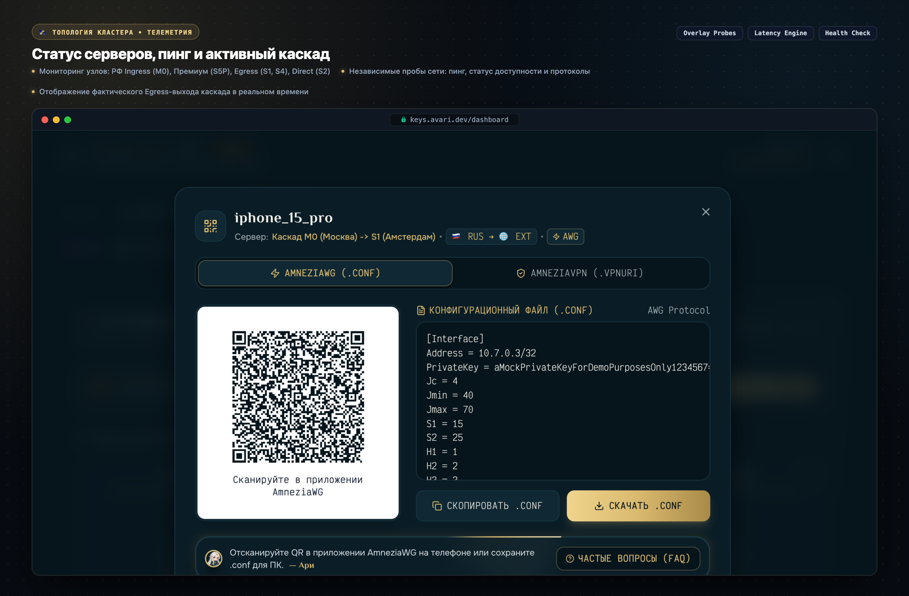
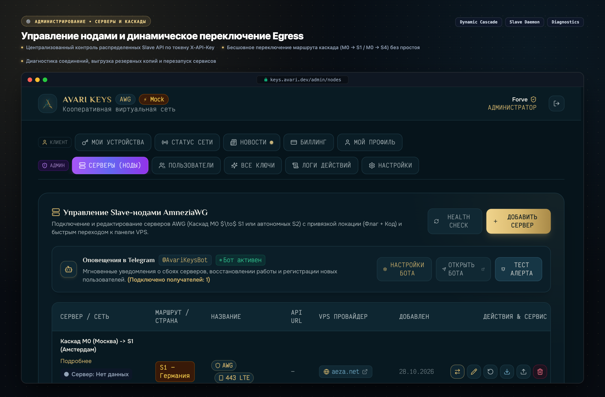
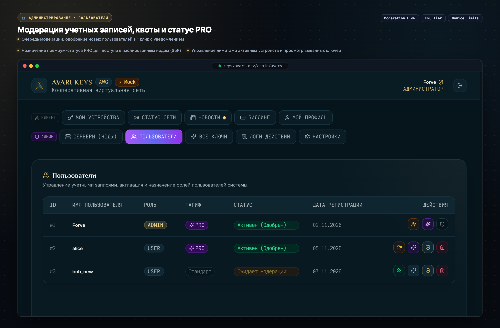
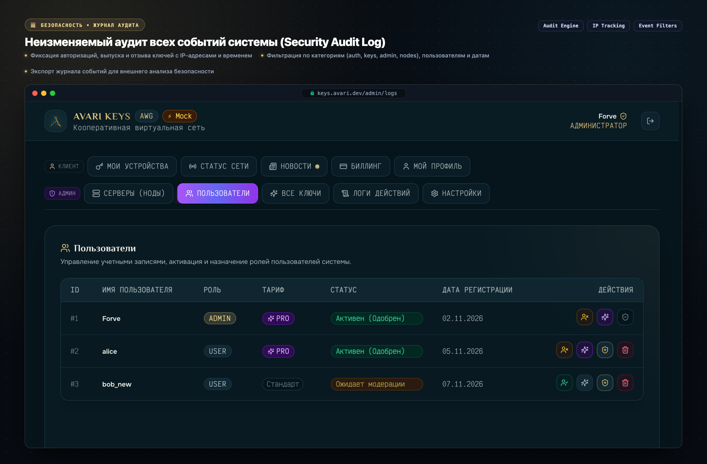
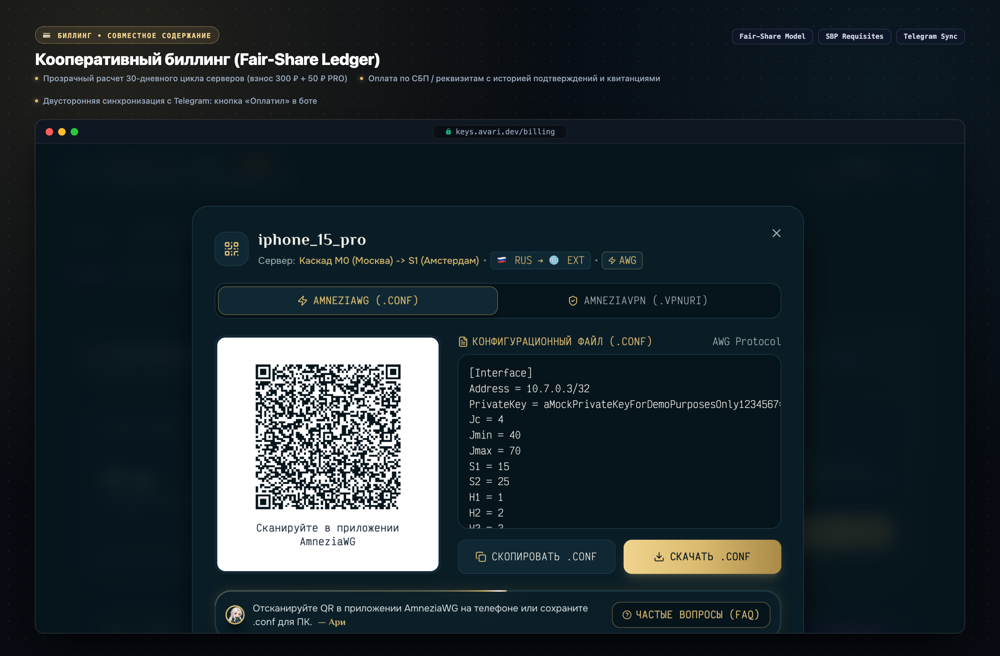
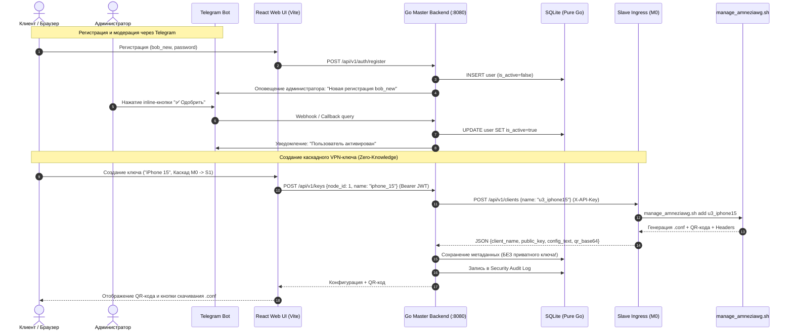

<div align="center">

  

  # AVARI KEYS
  ### 🛡️ Распределенная система оркестрации и управления AmneziaWG и Hysteria 2 VPN-ключами

  [](./_docs/RELEASE-v1.2.0.md)
  [](https://go.dev/)
  [-success?style=for-the-badge&logo=linux&logoColor=white)](https://pkg.go.dev/modernc.org/sqlite)
  [](https://react.dev/)
  [](https://www.typescriptlang.org/)
  [](https://tailwindcss.com/)
  [-E5A93C?style=for-the-badge&logo=wireguard&logoColor=white)](https://github.com/amnezia-vpn)
  [](https://v2.hysteria.network/)
  [](./LICENSE)

  <p align="center">
    <b>Полнофункциональная enterprise-grade панель для self-hosted управления VPN-инфраструктурой</b><br/>
    Двухкаскадное туннелирование (РФ Ingress &rarr; EU Egress) против блокировок DPI, изолированный PRO Ingress S5P, динамическое переключение Egress, глубокая экосистема Telegram Bot, Zero-CGo статические бинарники, журнал аудита и кооперативный биллинг.
  </p>

  <p align="center">
    <a href="#-быстрый-старт-демо-режим-за-30-секунд">⚡ Быстрый запуск Демо</a> •
    <a href="#-галерея-интерфейса-showcase">📸 Галерея интерфейса</a> •
    <a href="#-архитектура-и-сетевая-топология">🏛 Архитектура и топология</a> •
    <a href="#-технологический-стек">🛠 Стек технологий</a> •
    <a href="#-инженерные-решения-highlights">💡 Highlights</a>
  </p>

</div>

---

## 🌟 Ключевые возможности

- 🛡️ **Двухкаскадное и прямое туннелирование (Double-Hop Cascade & Direct Nodes)**:
  - **РФ Ingress $\to$ EU Egress**: Входной узел в РФ (M0) маскирует трафик от провайдеров и направляет его на зарубежную ноду выхода (S1 Нидерланды или S4 Egress EU).
  - **Динамическое переключение Egress**: Администратор может переключать точку выхода каскада на лету прямо из веб-интерфейса без перевыпуска клиентских ключей.
  - **Премиум-узел S5P (Санкт-Петербург)**: Выделенная инфраструктура с изолированным каскадным входом и прямым подключением для тарифа PRO.
  - **Автономные прямые ноды (Direct Nodes)**: Высокоскоростные прямые каналы без промежуточных хопов (S2 Германия, S5P Direct).
- ⚡ **Мультипротокольность и защита от DPI**:
  - **AmneziaWG (AWG)**: Генерация конфигураций с кастомными заголовками обфускации (`Jc`, `Jmin`, `Jmax`, `S1`, `S2`, `H1-H4`), экспорт `.conf` и QR-коды для мгновенного импорта в iOS / Android клиенты.
  - **Hysteria 2**: Высокопроизводительный протокол поверх UDP/QUIC с маскировкой под HTTPS-трафик для условий нестабильной связи и агрессивных блокировок.
- ⭐ **Тарифные планы (PRO) и резервные серверы**:
  - Разграничение прав доступа к высокоскоростным узлам (`is_pro`).
  - Маркировка серверов высокой доступности (`is_backup`) для автоматического резервирования.
- 🤖 **Глубокая экосистема Telegram Bot**:
  - Безопасная персональная привязка аккаунтов по одноразовым Deep Link токенам (`/start <token>`) и Decoy-заглушка для посторонних чатов.
  - Модерация новых пользователей и запросов сброса паролей через Inline-кнопки прямо в Telegram.
  - Интерактивный биллинг: автоматические напоминания об окончании 30-дневного расчетного периода и кнопка «Оплатил» в чате бота.
  - Рассылка новостей, анонсов и мгновенных алертов о здоровье серверов.
- 📰 **Система новостей и объявлений (News & Announcements)**:
  - Управление публикациями, черновики, категории (обновления кластера, технические работы, промо), баннеры в веб-панели и синхронизация с Telegram.
- 🧭 **Полноценный SPA-роутинг и история переходов**:
  - Навигация без хэшей через HTML5 History API (`/keys`, `/dashboard`, `/news`, `/billing`, `/faq`, `/settings`, `/admin/...`) с сохранением активной страницы при перезагрузке (F5 / Cmd+R) и поддержкой кнопок браузера «Назад» и «Вперёд».
  - Защищенный fallback для обычных пользователей при попытке перехода в админ-панель.
- 🧚 **Интерактивный чиби-маскот Ари**:
  - Помощник с прозрачным фоном, эмоциональными состояниями, контекстными подсказками и пошаговым онбординг-туром первого подключения.
- 📊 **Мониторинг, телеметрия и устойчивый Health Check**:
  - Независимые внешние пробы сетевых интерфейсов, опрос состояния через awg0 overlay туннели, замер задержки (ping) и статуса доступности.
  - Дельта-движок телеметрии AmneziaWG: точный учёт переданного и принятого трафика по PublicKey без дублирования счетчиков.
- 🔒 **Zero-CGo, статическая сборка и безопасность**:
  - Компиляция `CGO_ENABLED=0` без внешних `libc` зависимостей; реляционная БД SQLite на чистом Go ([`modernc.org/sqlite`](https://pkg.go.dev/modernc.org/sqlite)).
  - **Zero-Knowledge изоляция**: Master-сервер не хранит приватные ключи пользователей.
  - **Decoy Camouflage**: Нейтральная HTML-заглушка на Slave API демонах, скрывающая VPN-сервис от сетевых сканеров.
  - Полный аудит безопасности (**Security Audit Log**) с фиксацией IP-адресов, категорий событий и экспортом данных.
- 💳 **Кооперативный биллинг (Fair-Share Ledger)**:
  - Прозрачный учет 30-дневных циклов совместного содержания серверов (базовый взнос 300 ₽ + 50 ₽ PRO).
  - Быстрая оплата по СБП и банковским реквизитам с историей подтверждений.

---

## 📸 Галерея интерфейса (Showcase)

Все презентационные скриншоты сняты во **встроенном Демо-режиме** без необходимости подключения к реальным серверам AmneziaWG:

### 1. Экран авторизации, регистрация и Демо-вход
> Защищенная авторизация, запрос сброса паролей, чиби-маскот и встроенный демо-вход для ролей Alice / Admin Forve:

<div align="center">
  
</div>

---

### 2. Личный кабинет пользователя и дашборд VPN-ключей
> Список активных конфигураций, индикация типа ноды (Каскад РФ $\to$ EU / Direct), учет трафика по PublicKey и Telegram-баннер:

<div align="center">
  
</div>

---

### 3. Модальное окно ключа: AmneziaWG QR-код и обфускация DPI
> Генерация QR-кода на лету для мобильного приложения AmneziaWG, подсветка параметров защиты от DPI (`Jc`, `Jmin`, `Jmax`, `S1`, `S2`, `H1-H4`), копирование и скачивание `.conf`:

<div align="center">
  
</div>

---

### 4. Статус сети: топология кластера и телеметрия
> Мониторинг узлов в реальном времени: РФ Ingress (M0), Премиум (S5P), EU Egress (S1, S4), прямые ноды, пинг и протоколы (AWG / Hysteria 2):

<div align="center">
  
</div>

---

### 5. Панель администратора: Управление серверами и каскадами
> Централизованный контроль Slave-демонов, динамическое переключение точки выхода каскада (M0 $\to$ S1 / M0 $\to$ S4), статус доступности и бэкапы:

<div align="center">
  
</div>

---

### 6. Панель администратора: Модерация пользователей и тариф PRO
> Очередь подтверждения новых регистраций, активация аккаунтов в 1 клик, назначение статуса PRO и управление квотами устройств:

<div align="center">
  
</div>

---

### 7. Журнал аудита безопасности (Security Audit Logs)
> Полная хроника системных действий: авторизации, создание и отзыв ключей, смена паролей, действия администратора, IP-адреса и расширенная фильтрация:

<div align="center">
  
</div>

---

### 8. Кооперативный биллинг (Fair-Share Ledger)
> Прозрачный учет 30-дневного расчетного периода, разбивка взноса (300 ₽ базовый + 50 ₽ PRO), реквизиты СБП и подтверждение оплаты:

<div align="center">
  
</div>

---

## 🏛 Архитектура и сетевая топология

Система разделена на **Master** (центральный координатор с базой данных, Web UI и Telegram-ботом) и **Slave** (легковесные демоны на нодах с AmneziaWG и Hysteria 2):

```
                       ┌─────────────────────────────────────────────────────────┐
                       │                 ПОЛЬЗОВАТЕЛЬСКИЙ ТРАФИК                 │
                       └────────────────────────────┬────────────────────────────┘
                                                    │
                 ┌──────────────────────────────────┼──────────────────────────────────┐
                 │ (Обычный каскад)                 │ (Премиум PRO каскад)             │ (Прямое подключение)
                 ▼                                  ▼                                  ▼
    ┌─────────────────────────┐        ┌─────────────────────────┐        ┌─────────────────────────┐
    │     M0 (Россия/РФ)      │        │    S5P (РФ / СПб, PRO)  │        │       S2 (Германия)     │
    │  • Cascade Ingress      │        │  • PRO Cascade Ingress  │        │  • Direct Standalone    │
    │  • AWG (DPI обфускация) │        │  • PRO Direct Node      │        │  • AWG + Hysteria 2     │
    │  • Динамический Egress  │        │  • Изолированный контур │        │  • amneziawg0 interface │
    └────────────┬────────────┘        └────────────┬────────────┘        └────────────┬────────────┘
                 │                                  │                                  │
                 ├─────────────────┬────────────────┘                                  │
                 ▼                 ▼                                                   │
    ┌─────────────────────────┐ ┌─────────────────────────┐                            │
    │      S1 (Нидерланды)    │ │      S4 (Egress EU)     │                            │
    │  • Cascade Egress       │ │  • Cascade Egress       │                            │
    │  • NAT / Direct Out     │ │  • NAT / Direct Out     │                            │
    └────────────┬────────────┘ └────────────┬────────────┘                            │
                 │                           │                                         │
                 └───────────────────────────┴─────────────────────────────────────────┘
                                                    │
                                                    ▼
                                             [ ВЕСЬ ИНТЕРНЕТ ]
```

### Потоки управления и API-взаимодействие (Control Plane):



---

## 🛠 Технологический стек

| Слой | Технологии | Назначение / Особенности |
|---|---|---|
| **Backend Core** | **Go 1.22+** | Высокая производительность, статическая линковка, низкое потребление RAM (< 30 МБ). |
| **Сборка & CGo** | `CGO_ENABLED=0` | Полное отсутствие C-зависимостей, максимальная переносимость на любые Linux-дистрибутивы. |
| **База данных** | **`modernc.org/sqlite`** | Встроенный чистый Go SQLite драйвер с поддержкой транзакций, миграций и WAL-режима. |
| **Безопасность** | `golang-jwt/jwt/v5`, `golang.org/x/crypto/bcrypt` | Авторизация через JWT-токены, хеширование паролей bcrypt, изоляция private keys. |
| **Боты & Оповещения** | **Telegram Bot API** | Инлайн-модерация регистраций и сброса паролей, кнопка «Оплатил», уведомления и рассылки. |
| **Frontend UI** | **React 18**, **TypeScript 5.5** | Типобезопасный SPA интерфейс с модульной компонентной архитектурой. |
| **Сборка FE** | **Vite 5** | Сверхбыстрая сборка, HMR, оптимизация production бандлов. |
| **Маршрутизация** | **HTML5 History API** | Канонические URL без хэшей (`/keys`, `/dashboard`, `/news`, `/billing`, `/admin/...`), сохранение роута при F5. |
| **Стилизация** | **Tailwind CSS 3.4**, `lucide-react` | Адаптивный дизайн (Mobile 320px &rarr; 4K), Cyber-Fantasy тема, стеклянные панели (Glassmorphism). |
| **VPN Engine** | **AmneziaWG (AWG)** & **Hysteria 2** | WireGuard с обфускацией DPI (`Jc`, `Jmin`, `Jmax`, `S1`, `S2`, `H1-H4`) + быстрый UDP/QUIC туннель. |
| **Инфраструктура** | **Caddy Server**, **systemd**, **GitHub Actions** | Автоматический Let's Encrypt HTTPS, атомарный SSH CI/CD деплой за секунды. |

---

## ⚡ Быстрый старт (Демо-режим за 30 секунд)

Для локального ознакомления с интерфейсом не требуется установленный AmneziaWG или Linux VPS:

```bash
# 1. Клонирование репозитория
git clone https://github.com/OstKost/avari-keys-mvp.git
cd avari-keys-mvp

# 2. Установка зависимостей фронтенда
cd apps/frontend
npm install

# 3. Запуск встроенного Демо-режима (Mock Mode)
npm run dev:mock
```

Откройте в браузере **`http://localhost:3000`** (или предложенный порт Vite) и выберите:
- 🛡️ **Админ (Forve)** — полный доступ к серверам, модерации, аудиту, новостям и биллингу.
- 👤 **Клиент (Alice)** — личный кабинет пользователя с активными ключами и QR-кодами.

### Автоматическая генерация скриншотов Showcase:

```bash
# Генерация презентационных карточек интерфейса в высоком разрешении (Retina 2x)
cd apps/frontend
npm run screenshots
```

---

## 💻 Полноценный запуск в среде разработки

### Требования:
- Go 1.22+
- Node.js 20+
- Linux (для реального вызова `manage_amneziawg.sh`) или macOS/Windows (с mock runner).

### Запуск всех компонентов через Makefile:

```bash
# Сборка статических бинарников Master и Slave
make build

# Запуск всех модульных, контрактных и интеграционных тестов
make test

# Проверка линтером и компилятором
make vet
```

---

## 💡 Инженерные решения (Highlights)

### 1. Почему Zero-CGo (`CGO_ENABLED=0`)?
* **Идеальная переносимость**: Бинарник не привязан к системной версии `glibc` сервера сборщика. Собранный в GitHub Actions файл работает на Ubuntu 20.04, Debian 12 или Alpine.
* **Trivial Cross-Compilation**: Сборка под `linux/arm64` (AWS Graviton, Raspberry Pi) выполняется одной командой `GOOS=linux GOARCH=arm64 go build` без установки GCC кросс-компиляторов.
* **Быстрый CI/CD**: Сборка и деплой занимают менее 5 секунд.

### 2. Zero-Knowledge изоляция приватных ключей
* Сервер **Master** принципиально не сохраняет приватные ключи клиентов в SQLite.
* Ключ генерируется скриптом `manage_amneziawg.sh` на Slave-ноде и передается пользователю один раз при создании/просмотре. В базе Master сохраняются только публичные метаданные (`client_name`, `public_key`, `node_id`, `created_at`).

### 3. Защита Slave-нод и Decoy Camouflage
* При прямом обращении к Slave API по HTTP выдается нейтральная HTML-страница (Decoy), скрывающая факт работы VPN-сервиса от сканеров портов.
* Все управляющие эндпоинты защищены строгой проверкой токена `X-API-Key`.

### 4. Динамическое переключение Egress каскада
* Администратор может переключать зарубежный выход каскада (например, с S1 Нидерланды на S4 Egress EU) одной кнопкой в панели управления.
* Входной интерфейс M0 автоматически перенаправляет трафик через обновленный туннель без необходимости перевыпускать конфигурации пользователей.

### 5. Двусторонняя Telegram Bot синхронизация
* Администратор может утверждать регистрацию пользователей и подтверждать сброс паролей прямо из Telegram через Inline-кнопки без открытия веб-интерфейса.
* Пользователи получают напоминания об окончании 30-дневного расчетного периода и подтверждают взнос кнопкой «Оплатил» прямо в боте.

### 6. Настоящий SPA-роутинг через HTML5 History API
* Приложение использует канонические URL (`/keys`, `/dashboard`, `/news`, `/billing`, `/admin/nodes`, etc.).
* При перезагрузке страницы (F5) или переходе по прямой ссылке состояние интерфейса и активная вкладка сохраняются, а заголовок страницы `document.title` синхронизируется автоматически.

---

## 📁 Структура проекта

```
avari-keys-mvp/
├── _docs/                  # Архитектурная документация, сетевые схемы и Kanban
│   ├── ARCHITECTURE.md     # Спецификация сетевой топологии и API
│   ├── CASCADE_SIMPLE.md   # Руководство по настройке 2-hop каскада
│   ├── DEPLOY.md           # Инструкция по развертыванию на VPS
│   ├── CICD.md             # Описание GitHub Actions пайплайна
│   ├── RELEASE-v1.2.0.md   # Описание изменений релиза v1.2.0
│   ├── TASKS.md            # Kanban-доска проекта
│   └── screenshots/        # Презентационные скриншоты Showcase (App Store style)
├── apps/
│   ├── backend/            # Go 1.22+ Backend (Master + Slave Daemon)
│   │   ├── cmd/
│   │   │   ├── master/     # Точка входа Master Backend
│   │   │   └── slave/      # Точка входа Slave API Daemon
│   │   └── internal/       # Clean Architecture (auth, db, node, client, audit, telegram)
│   └── frontend/           # React 18 + TypeScript + Tailwind SPA
│       ├── public/assets/  # Логотипы и прозрачные ассеты чиби-маскота Ари
│       ├── scripts/        # Скрипт генерации скриншотов Showcase (Puppeteer)
│       ├── src/
│       │   ├── api/        # REST API клиент + встроенный MockClient
│       │   ├── components/ # Компоненты UI (Модалки, Дашборд, Маскот, Логи, Биллинг)
│       │   ├── utils/      # Модуль роутинга (HTML5 History API) и хелперы
│       │   └── types/      # DTO и TypeScript интерфейсы
├── deploy/                 # Конфигурации Caddy, systemd и скрипты инсталляции
├── scripts/                # Вспомогательные утилиты обслуживания кластера
├── Makefile                # Команды автоматизации (build, test, lint, dev)
└── README.md               # Презентация проекта для портфолио
```

---

## 📄 Лицензия

Проект распространяется под лицензией **MIT**. Подробности в файле [LICENSE](./LICENSE).

---

<div align="center">
  <sub>Разработано с ❤️ как демонстрация проектирования надежных распределенных сетевых систем на Go и React.</sub>
</div>
