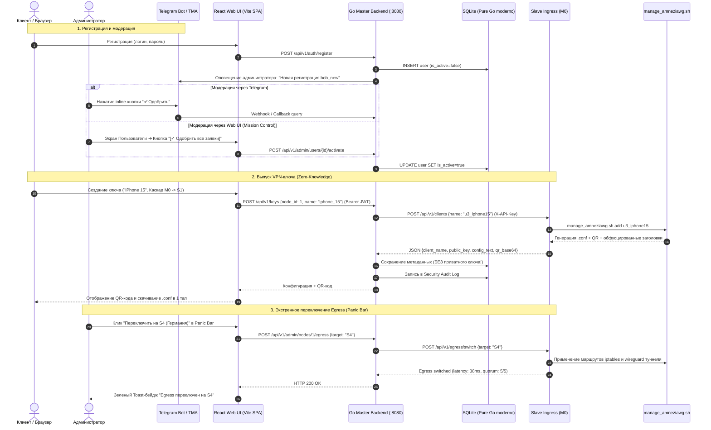

# Архитектура и сетевая топология Avari Keys

## 1. Введение и концепция

Платформа **Avari Keys** (v1.6.0+) — распределенная enterprise-grade система оркестрации конфигураций AmneziaWG (AWG) и Hysteria 2, ориентированная на обход ТСПУ/DPI-блокировок, отказоустойчивость инфраструктуры и разделение контекстов использования («Клиент» vs «Командный центр Mission Control»).

### Ключевые архитектурные принципы:
1. **Двухкаскадное туннелирование (Double-Hop Cascade)**:
   - Входной российский сервер (**M0 Ingress**) принимает обфусцированный трафик пользователей через AmneziaWG (DPI-заголовки `Jc`, `Jmin`, `Jmax`, `S1`, `S2`, `H1-H4`).
   - M0 перенаправляет трафик через зарубежный выходной шлюз (**Egress: S1 / S4**).
   - Российские операторы видят только соединение клиента с сервером в РФ, а интернет видит обращение с чистого зарубежного IP-адреса.
2. **Динамический Egress и Auto-Failover**:
   - Нативный Go-контроллер с мультипроверкой кворума (5 независимых целей: Google, Cloudflare, Telegram, ChatGPT, Meta/Grok).
   - При деградации или блокировке зарубежного шлюза система либо переключает его автоматически, либо администратор делает это в 1 клик через **Egress Panic Bar**.
   - Клиентские ключи и конфигурации остаются неизменными при смене Egress.
3. **PRO-сегментация и резервирование**:
   - Выделенный премиум-контур **S5P (Санкт-Петербург)** с изолированным каскадным входом и прямым подключением для тарифа PRO (`is_pro`).
   - Запасные серверы (`is_backup`) высокой доступности.
4. **Прямое мультипротокольное туннелирование (Direct Nodes)**:
   - Высокоскоростные прямые узлы (**S2 Германия**, **SBOX Нидерланды**) с поддержкой как AmneziaWG, так и **Hysteria 2** (UDP/QUIC протокол с HTTPS-маскировкой).
5. **Двухрежимный UX (Clean Dual-Mode)**:
   - **Личный кабинет («Клиент»)**: просмотр своих конфигураций, QR-кодов, статуса сети, новостей и баланса.
   - **Командный центр («Управление»)**: Mission Control сводка, топология каскада, Action Center, Egress Panic Bar, CRM пользователей (User Detail Drawer) и гигиена зомби-ключей.

---

## 2. Физическая топология кластера серверов

```
                       ┌─────────────────────────────────────────────────────────┐
                       │                 ПОЛЬЗОВАТЕЛЬСКИЙ ТРАФИК                 │
                       └────────────────────────────┬────────────────────────────┘
                                                    │
                 ┌──────────────────────────────────┼──────────────────────────────────┐
                 │ (Базовый каскад)                 │ (Премиум PRO каскад)             │ (Прямое подключение Direct)
                 ▼                                  ▼                                  ▼
    ┌─────────────────────────┐        ┌─────────────────────────┐        ┌─────────────────────────┐
    │     M0 (Россия, Москва) │        │    S5P (РФ / СПб, PRO)  │        │   S2 (Германия) / SBOX  │
    │  • Cascade Ingress      │        │  • PRO Cascade Ingress  │        │  • Direct Standalone    │
    │  • AWG (DPI обфускация) │        │  • PRO Direct Node      │        │  • AWG + Hysteria 2     │
    │  • Master API & Web UI  │        │  • Изолированный контур │        │  • Decoy Stub Website   │
    │  • Динамический Egress  │        │  • Высокая скорость     │        │  • amneziawg0 interface │
    └────────────┬────────────┘        └────────────┬────────────┘        └────────────┬────────────┘
                 │                                  │                                  │
                 ├─────────────────┬────────────────┘                                  │
                 ▼                 ▼                                                   │
    ┌─────────────────────────┐ ┌─────────────────────────┐                            │
    │     S1 (Нидерланды)     │ │       S4 (Германия)     │                            │
    │  • Cascade Egress       │ │  • Cascade Egress (Бэкап)│                            │
    │  • NAT / Direct Out     │ │  • NAT / Direct Out     │                            │
    │  • Quorum Health Check  │ │  • Quorum Health Check  │                            │
    └────────────┬────────────┘ └────────────┬────────────┘                            │
                 │                           │                                         │
                 └───────────────────────────┴─────────────────────────────────────────┘
                                                    │
                                                    ▼
                                             [ ВЕСЬ ИНТЕРНЕТ ]
```

### Реестр нод кластера:

| Нода | Локация | Роль в VPN | Протоколы | Сервисы и особенности |
|---|---|---|---|---|
| **M0** | Россия (Москва) | Master + Cascade Ingress | AmneziaWG (AWG) | Web UI, Master API (:8080), Cascade Slave API (:8081), Egress Manager, Telegram Bot |
| **S1** | Нидерланды (EU) | Cascade Egress | AWG WireGuard | Шлюз выхода каскада по умолчанию, NAT, пробы доступности |
| **S4** | Германия (EU) | Cascade Egress (Резерв) | AWG WireGuard | Альтернативный шлюз выхода, автоматический Failover при блокировках S1 |
| **S5P** | Россия (Санкт-Петербург) | PRO Ingress + PRO Direct | AWG (DPI обфускация) | Выделенный сервер для пользователей с тарифом PRO, изолированная маршрутизация |
| **S2** | Германия (EU) | Standalone Direct Node | AWG + Hysteria 2 | Прямой зарубежный сервер, Slave API (:8081), Decoy-маскировка |
| **SBOX** | Нидерланды (EU) | Standalone Direct Node | AWG + Hysteria 2 | Высокоскоростной прямой сервер, Slave API (:8081), Decoy-маскировка |

---

## 3. Взаимодействие компонентов (Control Plane)



---

## 4. Двухрежимная архитектура фронтенда (Dual-Mode Routing)

Маршрутизация реализована без хэшей поверх **HTML5 History API** ([`apps/frontend/src/utils/route.ts`](file:///Volumes/KingstonM2/Projects/avari-keys-mvp/apps/frontend/src/utils/route.ts)):

```
                                  [ АВТОРИЗАЦИЯ ]
                                         │
                        ┌────────────────┴────────────────┐
                        ▼                                 ▼
             [ 👤 ЛИЧНЫЙ КАБИНЕТ ]             [ ⚡ ЦЕНТР УПРАВЛЕНИЯ ]
             (Обычные пользователи +           (Только администраторы,
              повседневный вид админа)          режим Mission Control)
                        │                                 │
         ┌──────────────┼──────────────┐   ┌──────────────┼──────────────┐
         ▼              ▼              ▼   ▼              ▼              ▼
     /keys         /dashboard       /news  /overview  /admin/nodes  /admin/users
   (Мои ключи)    (Статус сети)  /billing (Сводка +   (Серверы)     (CRM + Drawer)
                                 /faq      Panic Bar)              /admin/keys
                                 /settings                         /admin/audit
                                                                   /admin/telegram
```

- **Синхронизация режима**: активный режим сохраняется в `localStorage` (`avari_app_mode`) и синхронизирован с URL.
- **Индикатор внимания**: кнопка переключения режимов в шапке отображает пульсирующую точку при наличии ожидающих модерации пользователей или сбросов паролей.
- **Безопасность перехода**: при попытке обычного пользователя перейти по админскому URL происходит мягкий редирект в личный кабинет с уведомлением.

---

## 5. Движок отказоустойчивости Egress (Auto-Failover & Quorum)

Контроллер шлюзов выхода каскада непрерывно валидирует доступность внешнего интернета:
1. **Мультипроверка кворума (5 независимых таргетов)**:
   - `Google DNS` (`8.8.8.8:53`)
   - `Cloudflare DNS` (`1.1.1.1:53`)
   - `Telegram API` (`core.telegram.org:443`)
   - `ChatGPT / OpenAI` (`api.openai.com:443`)
   - `Meta / Grok API`
2. **Правило кворума**: Шлюз считается здоровым при успехе $\ge 3$ проверок из 5.
3. **Алгоритм защиты от дребезга (Safety Gate & Fast Retry)**:
   - При единичном сбое запускается быстрый цикл проверки через 30 секунд.
   - Если статус не восстановился за `FailCountThreshold` (по умолчанию 3), активируется переключение на резервный Egress из списка приоритетов.
   - Cooldown-период предотвращает частые циклы переключения при нестабильном канале.

---

## 6. Спецификация API

### Slave API (Ноды M0, S2, SBOX)
Демон `systemd` на порту `:8081` с авторизацией по заголовку `X-API-Key`:
- `GET /` — нейтральная HTML Decoy-страница (маскировка под тестовый HTTP-сервер).
- `GET /health` — проверка статуса сервиса, доступности `manage_amneziawg.sh` и Hysteria 2.
- `POST /api/v1/clients` — создание пира: генерация конфигурации, QR-кода и ключей.
- `GET /api/v1/clients` — список активных клиентов на ноде.
- `GET /api/v1/clients/{name}` — получение конфигурации конкретного клиента.
- `DELETE /api/v1/clients/{name}` — отзыв и удаление пира через CLI.
- `GET /api/v1/stats` — метрики переданного/принятого трафика и времени последнего рукопожатия.
- `GET /api/v1/egress/status` — текущий статус Egress-шлюза каскада и замеры задержки.
- `POST /api/v1/egress/switch` — применение нового маршрута выхода каскада.

### Master Backend API (M0)
Центральный шлюз на порту `:8080` (JWT Bearer Token):
- **Авторизация**: `POST /api/v1/auth/login`, `POST /api/v1/auth/register`, `POST /api/v1/auth/reset-password`.
- **Клиентские ключи**: `GET /api/v1/keys`, `POST /api/v1/keys`, `DELETE /api/v1/keys/{id}`.
- **Статус сети**: `GET /api/v1/network/status` (независимые пробы узлов кластера).
- **Биллинг & Новости**: `GET /api/v1/billing`, `POST /api/v1/billing/pay`, `GET /api/v1/news`.
- **Admin Mission Control**:
  - `GET /api/v1/admin/dashboard` — сводные метрики кластера и очереди действий.
  - `GET /api/v1/admin/nodes` / `PUT /api/v1/admin/nodes/{id}` — управление серверами.
  - `GET /api/v1/admin/nodes/{id}/egress` / `POST /api/v1/admin/nodes/{id}/egress` — переключение Egress.
  - `GET /api/v1/admin/nodes/{id}/failover` / `PUT /api/v1/admin/nodes/{id}/failover` — настройки Auto-Failover.
  - `GET /api/v1/admin/users` / `POST /api/v1/admin/users/{id}/activate` — модерация и CRM пользователей.
  - `GET /api/v1/admin/keys` — реестр всех ключей с фильтрацией по статусу активности и заполнению IP-подсети.
  - `GET /api/v1/admin/audit` — системный журнал аудита безопасности.
- **Telegram Webhook**: эндпоинты обработки callback-запросов бота и валидации сессий Telegram Mini App (TMA).

---

## 7. Инварианты безопасности системы

1. **Zero-CGo / Single Static Binary**:
   - Master и Slave собираются со флагом `CGO_ENABLED=0`.
   - SQLite работает на чистом Go (`modernc.org/sqlite`) без внешних runtime-библиотек C.
2. **Zero-Knowledge изоляция приватных ключей**:
   - Master хранит в базе данных исключительно публичные метаданные (`client_name`, `public_key`, `node_id`, `created_at`). Приватные ключи клиентов никогда не сохраняются на центральном сервере.
3. **Decoy-маскировка сетевых сканеров**:
   - Корневые эндпоинты Slave API отдают нейтральный контент заглушки, скрывая присутствие VPN-демона.
   - Telegram-бот отвечает посторонним аккаунтам в нейтральном decoy-стиле без раскрытия функционала сервиса.
4. **Безопасность телеметрии (Curve25519 & Delta Engine)**:
   - Данные трафика аккумулируются через инкрементальный движок дельт в SQLite. Сброс счетчиков ОС или перезапуск ноды не искажает статистику пользователей.
