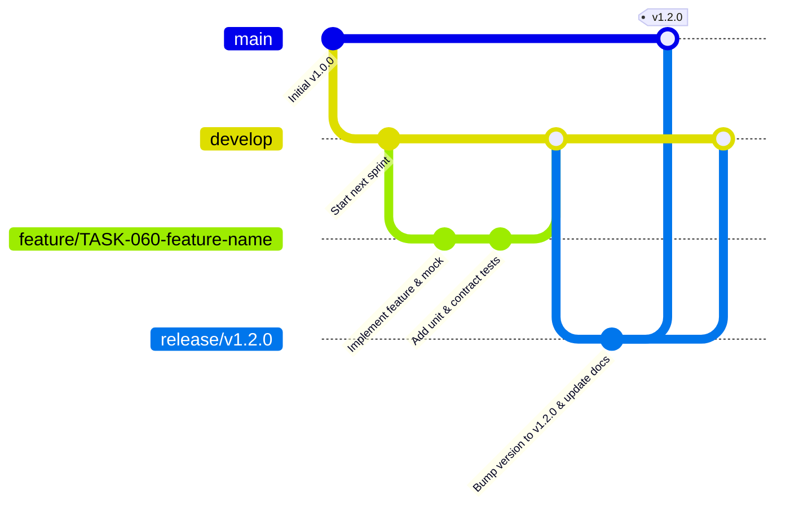

## 5. Gitflow и управление ветками

### Правила веток:
1. **`main`**: Защищенная ветка. Содержит только стабильные протестированные релизы с тегами `vX.Y.Z`. Прямые коммиты запрещены.
2. **`develop`**: Главная интеграционная ветка. В нее сливаются протестированные фичи и фиксы.
3. **`feature/<TASK-ID>-<slug>`**:
   - Ветка под задачу из [`_docs/TASKS.md`](file:///Volumes/KingstonM2/Projects/avari-keys-mvp/_docs/TASKS.md) (например, `feature/TASK-060-speedtest-integration`).
   - Создается от актуального `develop`.
   - По завершении и прохождении проверок сливается в `develop`.
4. **`release/vX.Y.Z`**:
   - Создается от `develop` перед релизом.
   - Проводится финальный прогон тестов, обновляется версия в `package.json`, создается `_docs/RELEASE-vX.Y.Z.md`.
   - Сливается в `main` (с простановкой тега `vX.Y.Z`) и обратно в `develop`.
5. **`hotfix/vX.Y.Z`**:
   - Создается от `main` при критических инцидентах на проде. Сливается в `main` и в `develop`.

---
