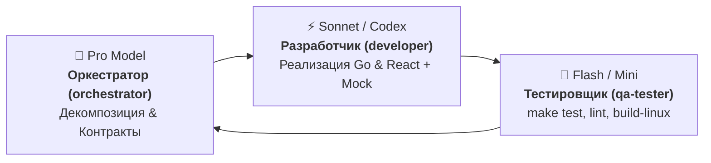

## 6. Ролевая модель агентов и универсальные наборы для моделей

В разработке проекта участвуют три функциональные роли, для каждой из которых подготовлен локальный скилл в `.agents/skills/`:

| Роль | Основная зона ответственности | Локальный скилл |
|---|---|---|
| **Оркестратор / Архитектор** | Декомпозиция задач, ведение [`_docs/TASKS.md`](file:///Volumes/KingstonM2/Projects/avari-keys-mvp/_docs/TASKS.md), контроль Gitflow, архитектурные решения, координация, подготовка релизов. | [`orchestrator`](file:///.agents/skills/orchestrator/SKILL.md) |
| **Разработчик / Исполнитель** | Написание Go и React кода, реализация DTO, синхронизация `client.ts` и `mockClient.ts`, модульные и контрактные тесты, фиксы багов. | [`developer`](file:///.agents/skills/developer/SKILL.md) |
| **Тестировщик / Верификатор** | Запуск тестов (`go test -race`), статический анализ (`go vet`), Zero-CGO Linux кросс-компиляция, сборка фронтенда (`npm run build`). | [`qa-tester`](file:///.agents/skills/qa-tester/SKILL.md) |

### Универсальные наборы под классы моделей

В зависимости от используемой модели (Claude, Gemini, OpenAI, DeepSeek и др.) выбирается соответствующий пресет:

#### 1. Heavyweight / Reasoning модели (Gemini 1.5/2.0/3.0 Pro, Claude 3.5 Sonnet / Opus, OpenAI o1/o3-mini)
- **Целевые роли**: **Оркестратор / Архитектор** либо **Сложный рефакторинг ядра**.
- **Активные скиллы**: [`orchestrator`](file:///.agents/skills/orchestrator/SKILL.md) + [`developer`](file:///.agents/skills/developer/SKILL.md).
- **Сильные стороны**: Анализ граничных условий, проектирование контрактов API, сложных SQLite миграций, декомпозиция крупных фич, подготовка handoff и аудит безопасности.

#### 2. Code Specialist модели (Codex, Claude 3.5 Sonnet, DeepSeek-Coder, Qwen Coder)
- **Целевая роль**: **Fullstack-разработчик (Go Backend + React Frontend)**.
- **Активный скилл**: [`developer`](file:///.agents/skills/developer/SKILL.md).
- **Сильные стороны**: Идиоматичный Go 1.22+, Zero-CGO чистый SQLite, изоляция build-тегов Linux/Darwin, строгая синхронизация `mockClient.ts`, разработка Cyber-Fantasy UI компонентов.

#### 3. Fast / High-Throughput модели (Gemini Flash / Flash-Lite, GPT-4o-mini, Claude Haiku)
- **Целевые роли**: **QA-инженер / Тестировщик**, **точечные UI-правки**, **генерация мок-данных**.
- **Активные скиллы**: [`qa-tester`](file:///.agents/skills/qa-tester/SKILL.md) (основной) или [`developer`](file:///.agents/skills/developer/SKILL.md) (для точечных правок).
- **Сильные стороны**: Мгновенный запуск и разбор логов тестов, исправление линтер-ошибок, верстка CSS-стилей, наполнение демо-данных без лишнего расхода квот.

---

### ⭐ Рекомендуемый набор (Golden Preset)

Для оптимального баланса скорости, качества кода и экономии квот рекомендуется следующая связка:



1. **Фаза планирования и архитектуры**: Модель класса **Pro** (Gemini Pro / Sonnet / o1) со скиллом [`orchestrator`](file:///.agents/skills/orchestrator/SKILL.md).
2. **Фаза кодинга**: Модель класса **Code Specialist** (Codex / Sonnet / Pro) со скиллом [`developer`](file:///.agents/skills/developer/SKILL.md).
3. **Фаза верификации и тестов**: Модель класса **Fast** (Flash / GPT-4o-mini) со скиллом [`qa-tester`](file:///.agents/skills/qa-tester/SKILL.md).

---

### Протокол передачи задачи (Handoff)

Передача задачи между агентами фиксируется в формате:

```markdown
### Handoff: [Роль/Модель -> Роль/Модель]
- **Ветка**: `feature/TASK-XXX-...`
- **Задача**: `_docs/tasks/TASK-XXX.md`
- **Объем изменений**: [Краткое резюме сделанного/требуемого]
- **Ключевые файлы**: [`apps/backend/...`](file:///...) / [`apps/frontend/...`](file:///...)
- **Синхронизация Mock Mode**: [Обновлен ли mockClient.ts (Да/Нет/Не применимо)]
- **Результаты проверки**: [Статус выполнения `make test` и `npm run build`]
- **Следующий шаг / Риски**: [Четкие инструкции следующему агенту]
```

---
