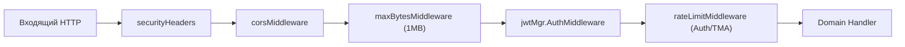

# Архитектура бэкенда (Master & Slave)

## 1. Обзор архитектуры

Бэкенд Avari Keys состоит из двух автономных Go-сервисов (`CGO_ENABLED=0`):
1. **Master API Gateway** (`cmd/master/main.go`): Центральный координатор, веб-сервер API, аутентификация, биллинг, мониторинг и Telegram-бот.
2. **Slave Node Agent** (`cmd/slave/main.go`): Легковесный агент на каждой VPN-ноде, управляющий интерфейсами WireGuard / AmneziaWG через скрипт `manage_amneziawg.sh`.

---

## 2. Структура Master API (`internal/master/`)

В рамках **TASK-078** монолитный `server.go` декомпозирован на логические доменные обработчики:

```text
apps/backend/internal/master/
├── server.go             # Config, Server struct, роутинг, middleware chain, хелперы
├── handlers_auth.go      # /api/v1/auth/* (register, login, me, reset-password, TMA)
├── handlers_keys.go      # /api/v1/keys/* (CRUD пользовательских ключей, транслитерация)
├── handlers_nodes.go     # /api/v1/nodes, /api/v1/admin/nodes/* (управление, Egress, Failover)
├── handlers_admin.go     # /api/v1/admin/users/*, audit-logs, telegram-настройки
├── handlers_billing.go   # /api/v1/billing/*, дашборд статистики
├── handlers_news.go      # /api/v1/news, /api/v1/admin/news/* (публикация, рассылка в TG)
└── ratelimit.go          # In-memory sliding-window IPRateLimiter (TASK-077)
```

### Пайплайн Middleware (`server.Handler()`)
Запросы проходят следующую цепочку:


1. **`securityHeadersMiddleware`**: Устанавливает CSP, `X-Content-Type-Options: nosniff`, `X-XSS-Protection`, `Referrer-Policy`.
2. **`maxBytesMiddleware(1<<20)`**: Ограничивает тело запроса 1 МБ (защита от memory exhaustion DoS), возвращает HTTP 413.
3. **`rateLimitMiddleware`**: Скользящее окно `IPRateLimiter` (5 req/min на auth, 3 req/min на reset, 15 req/min на TMA).
4. **`decodeJSON(w, r, &req)`**: Безопасный JSON-парсер с перехватом `http.MaxBytesError`.
5. **`auth.RequireAuth` / `auth.RequireAdmin`**: Валидация JWT токена и RBAC-контекста.

---

## 3. Структура Slave Node Agent (`internal/slave/`)

### Decoy-маскировка и безопасность
- Корневой эндпоинт `GET /` отдает HTML-страницу-заглушку (Decoy), маскирующую сервер от ZMap/Shodan-сканеров портов.
- Все вызовы от Master к Slave защищены заголовком `X-API-Key`. Сравнение ключа выполняется через `subtle.ConstantTimeCompare`.
- HTTP-хук аутентификации Hysteria 2 изолирован на loopback (`127.0.0.1`, `::1`).

### Абстракция Runner (`internal/runner/`)
Все вызовы AmneziaWG изолированы интерфейсом `AWGRunner`:
- **`RealRunner`** (`real_runner.go`): Вызывает `/root/awg/manage_amneziawg.sh` через `os/exec`.
- **`MockRunner`** (`mock_runner.go`): Эмулирует поведение скрипта, создание и отзыв конфигов в dev/тестах.

### CLI-режим управления Egress
Бинарник `avari-slave` поддерживает запуск в режиме утилиты командной строки:
```bash
avari-slave status        # Проверка текущего статуса Egress и целей
avari-slave switch awg3   # Переключение Egress каскада на интерфейс awg3
avari-slave recover       # Восстановление незавершенной транзакции переключения
```

---

## 4. Мультипротокольные контроллеры

Кроме AmneziaWG, в системе реализованы контроллеры альтернативных протоколов:
- **Hysteria 2** (`internal/hysteria/`): UDP/QUIC туннелирование, генерация паролей клиентов, HTTP auth hook.
- **Mieru** (`internal/mieru/`): Скрытный TCP-прокси на базе `mita` и `mieru-admin` API (`:9081/v1`), выдача `mierus://` JSON-конфигов.
- **VLESS Reality** (`internal/vless/`): Xray/Sing-box Reality конфигурации для прямых нод.

---

## 5. Логирование (`internal/logger/`)

- Реализовано на базе стандартного Go 1.22+ пакета `log/slog`.
- **Переменные окружения**:
  - `LOG_FORMAT`: `json` (для production/journald/Loki) или `text` (по умолчанию, для dev).
  - `LOG_LEVEL`: `debug`, `info`, `warn`, `error` (по умолчанию `info`).
- **Мост `log.Print`**: Все вызовы сторонних библиотек через стандартный пакет `log` автоматически перенаправляются в `slog`.

---

## 6. Кросс-компиляция и build tags

Низкоуровневые вызовы работы с сетью (привязка сокетов к сетевому интерфейсу `SO_BINDTODEVICE`) изолированы build-тегами:
- `apps/backend/internal/netprobe/probe_linux.go`: `//go:build linux`
- `apps/backend/internal/netprobe/probe_other.go`: `//go:build !linux`
Все бинарники обязаны собираться как под Darwin (macOS рабочая станция), так и под Linux amd64/arm64 (`make build-linux`).
