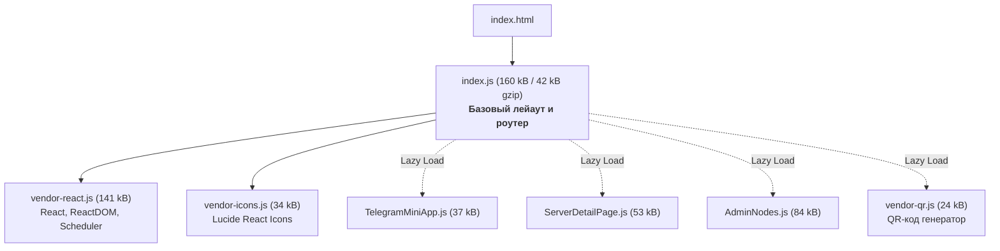

# Архитектура фронтенда (React SPA)

## 1. Стек технологий и дизайн-система

- **Стек**: React 18.3 / TypeScript 5.5 / Vite 5.4 / Tailwind CSS.
- **Дизайн-система (Cyber-Fantasy)**:
  - Фоновая палитра: глубокие темные тона (`#0c0d12`, `#13151f`, `#181a27`).
  - Акцентный цвет: благородное золото/янтарь (`#d9b96e`, `text-[#d9b96e]`, `border-[#d9b96e]/30`).
  - Элементы интерфейса: стеклянный матовый эффект (`backdrop-blur-md`), тонкие границы (`border-white/5`), неоновые акценты статусов.
  - Фирменный маскот: интерактивный Чиби-маскот Ари ([`ChibiMascot.tsx`](file:///Volumes/KingstonM2/Projects/avari-keys-mvp/apps/frontend/src/components/ChibiMascot.tsx)).
  - Плавные модальные окна: порталы с анимацией прозрачности ([`animatedPortal.tsx`](file:///Volumes/KingstonM2/Projects/avari-keys-mvp/apps/frontend/src/components/animatedPortal.tsx)).

---

## 2. Оптимизация бандла и Code-Splitting (TASK-079)

В рамках **TASK-079** монолитный JS-бандл (ранее весивший 745 кБ) был разделен на изолированные чанки, что снизило размер точки входа до **160 кБ (сокращение на 78%)**:



### 2.1 Конфигурация Rollup Manual Chunks (`vite.config.ts`)
```typescript
build: {
  rollupOptions: {
    output: {
      manualChunks: {
        'vendor-react': ['react', 'react-dom'],
        'vendor-icons': ['lucide-react'],
        'vendor-qr': ['qrcode'],
      },
    },
  },
}
```

### 2.2 Динамический импорт экранов (`React.lazy`)
Тяжелые административные разделы, экраны детальной диагностики и Telegram Mini App загружаются по требованию через `React.lazy()` и обернуты в `<Suspense>` с легковесным скелетоном загрузки.

---

## 3. Навигация и сохранение состояния (HTML5 History API)

В приложении не используются тяжелые сторонние роутеры (например, `react-router-dom`). Навигация реализована нативно через модуль [`apps/frontend/src/utils/route.ts`](file:///Volumes/KingstonM2/Projects/avari-keys-mvp/apps/frontend/src/utils/route.ts):
- Вызовы `navigate(path)` используют `window.history.pushState`.
- Слушатель события `popstate` обеспечивает корректную работу кнопок «Назад»/«Вперед» в браузере.
- Текущая вкладка и открытый экран сохраняются при обновлении страницы (F5).

---

## 4. Паритет боевого и демонстрационного API-клиента

> [!IMPORTANT]
> **Критический архитектурный инвариант проекта**:
> Фронтенд обязан поддерживать полноценный локальный демо-режим:
> ```bash
> npm run dev:mock
> ```
> При добавлении любых новых эндпоинтов, DTO или изменении форматов ответов разработчик **обязан синхронно** обновить:
> 1. Боевой клиент: [`apps/frontend/src/api/client.ts`](file:///Volumes/KingstonM2/Projects/avari-keys-mvp/apps/frontend/src/api/client.ts)
> 2. Мок-клиент: [`apps/frontend/src/api/mockClient.ts`](file:///Volumes/KingstonM2/Projects/avari-keys-mvp/apps/frontend/src/api/mockClient.ts)
> Поломка `npm run dev:mock` или расхождение интерфейсов является блокирующей ошибкой.
