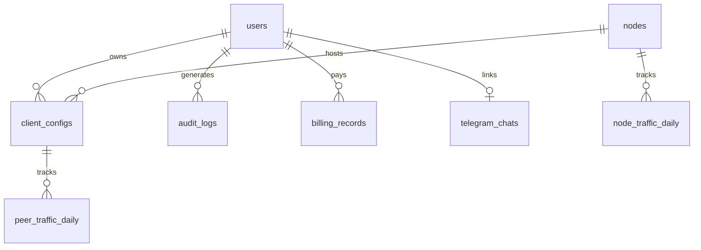

# Слой данных, схема БД и миграции (SQLite)

## 1. Обзор СХД

Хранилище данных Master реализовано на базе встроенной реляционной СУБД SQLite:
- **Драйвер**: Чистый Go `modernc.org/sqlite` (без внешних зависимостей от libc и CGo).
- **Расположение по умолчанию**: `./data/avari-master.db` (на проде: `/opt/avari-keys/data/avari-master.db`).
- **Режим работы (PRAGMA)**:
  - `PRAGMA journal_mode = WAL;` (Write-Ahead Logging для параллельного чтения и быстрой записи).
  - `PRAGMA foreign_keys = ON;` (контроль целостности внешних ключей и каскадного удаления).
  - `PRAGMA busy_timeout = 5000;` (ожидание до 5 секунд при конкурентных блокировках).

> [!IMPORTANT]
> **Инвариант изоляции приватных ключей**:
> Таблица `client_configs` хранит только `public_key`, `client_name`, `ip_address`, `protocol` и метаданные. Приватные ключи генерируются на нодах и **никогда не попадают в БД Master**.

---

## 2. Схема таблиц базы данных

| Таблица | Назначение | Ключевые поля |
|---|---|---|
| `schema_migrations` | Версионирование миграций (TASK-078) | `version` (INT PK), `applied_at` (DATETIME) |
| `users` | Учетные записи пользователей | `id`, `username`, `password_hash`, `role`, `is_active`, `is_pro` |
| `nodes` | Реестр серверов кластера | `id`, `name`, `type`, `country_code`, `api_url`, `api_key`, `is_backup`, `has_hysteria`, `has_mieru`, `has_vless`, `auto_failover_enabled`, `failover_priority` |
| `client_configs` | Выданные конфигурации ключей | `id`, `user_id`, `node_id`, `client_name`, `public_key`, `ip_address`, `protocol`, `is_active` |
| `peer_traffic_daily` | Посуточная статистика по ключам | `date` (YYYY-MM-DD), `client_config_id`, `rx_bytes`, `tx_bytes` |
| `node_traffic_daily` | Посуточная статистика по серверам | `date` (YYYY-MM-DD), `node_id`, `rx_bytes`, `tx_bytes` |
| `audit_logs` | Журнал действий пользователей и админов | `id`, `user_id`, `username`, `action`, `category`, `ip_address`, `details`, `created_at` |
| `billing_records` | История взносов пользователей | `id`, `user_id`, `username`, `amount`, `period_month`, `status`, `note` |
| `announcements` | Новости и системные оповещения | `id`, `title`, `content`, `category`, `is_pinned`, `author_name` |
| `telegram_chats` | Привязанные Telegram аккаунты | `chat_id`, `user_id`, `username`, `first_name`, `is_admin` |
| `telegram_link_tokens` | Одноразовые токены связывания с ботом | `token`, `user_id`, `created_at` |
| `password_reset_requests` | Заявки на сброс пароля | `id`, `user_id`, `new_password_hash`, `status`, `created_at`, `updated_at` |

---

## 3. Движок версионированных миграций

В рамках **TASK-078** реализована встроенная система версионированных миграций:
1. Таблица `schema_migrations` отслеживает текущую примененную версию схемы.
2. При вызове `NewSQLiteStorage(dbPath)` метод `runMigrations(db)` последовательно применяет необходимые шаги:
   - **Версия 1**: Базовая схема (пользователи, ноды, ключи, аудит, биллинг, новости, телеметрия).
   - **Версия 2**: Добавление поддержки `has_vless` в таблицу `nodes` и `protocol` в `client_configs`.
3. Для обеспечения 100% обратной совместимости с существующими БД и специфическими тестами вызывается вспомогательный метод `ensureColumns(db)`, проверяющий наличие колонок через `PRAGMA table_info`.

---

## 4. Фоновый воркер ротации (RetentionWorker)

Для предотвращения бесконечного разрастания SQLite-базы на VPS в рамках **TASK-081** реализован `retention.Worker` (`apps/backend/internal/retention/worker.go`):

### Политики очистки:
- **`audit_logs`**: Удаляются записи старше **30 дней** (`AUDIT_RETENTION_DAYS`).
- **`peer_traffic_daily`** и **`node_traffic_daily`**: Удаляются записи старше **90 дней** (`TELEMETRY_RETENTION_DAYS`).
- **`password_reset_requests`**: Удаляются завершенные (`status != 'pending'`) заявки старше **14 дней**.
- **`telegram_link_tokens`**: Удаляются токены старше **7 дней**.

### Запуск и управление:
- Воркер запускается автоматически в `Server.StartBackgroundWorkers(ctx)`.
- Период запуска: раз в **24 часа** (первый запуск через 10 секунд после старта сервера).
- Корректное завершение при SIGTERM через `Server.StopBackgroundWorkers()`.
- Итоги очистки логируются структурированно через `slog.Info`:
  `"Retention cleanup cycle completed", "total_deleted", N, "duration_ms", ms`.
